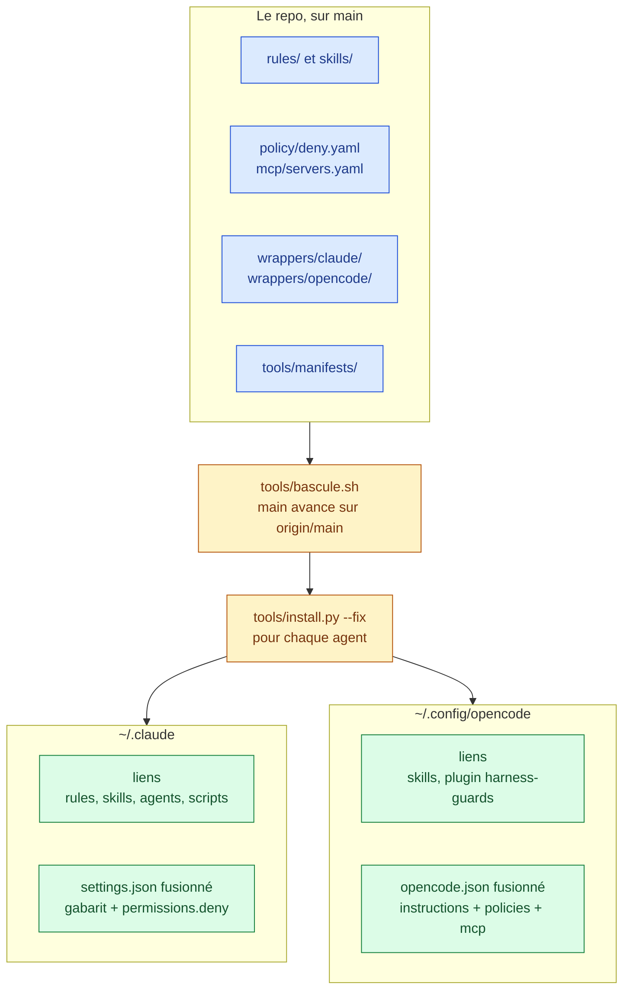

# agent-config

Un harnais partagé par deux agents de code, Claude Code et OpenCode. Le repo porte trois choses :

- des **règles**, chargées en contexte à chaque session (`rules/`)
- des **skills**, des expertises chargées à la demande (`skills/`)
- des **gardes**, qui refusent à l'appel ce qu'une règle de prose ne tient pas (`hooks/`, `policy/`)

Chaque source est écrite une fois, et `tools/install.py` la traduit dans la config de chaque agent. L'outillage du harnais (installation, banc, lint, évals, CI) vit dans `tools/`.

| Je veux | Section |
|---|---|
| installer le harnais sur une machine | [Démarrage rapide](#démarrage-rapide) |
| comprendre d'où vient la config de chaque agent | [Comment le harnais se configure](#comment-le-harnais-se-configure) |
| modifier une règle, un skill, un garde ou un réglage | [Faire un changement](#faire-un-changement) |
| savoir ce que fait un mécanisme précis | [Référence du harnais](#référence-du-harnais) |
| connaître l'écart entre Claude Code et OpenCode | [Particularités par agent](#particularités-par-agent) |
| tester, mesurer, linter | [Outillage](#outillage) |
| ajouter un fichier au bon endroit | [Contribuer](#contribuer) |

## Démarrage rapide

**1. Les prérequis.** Il faut `git` et `python3`, puis `claude` ou `opencode`, ou les deux. `node` sert à la batterie du plugin OpenCode, et `npm` à installer CodeGraph (voir [CodeGraph sur les projets AIDD](#codegraph-sur-les-projets-aidd)).

**2. Le checkout principal et le worktree.** Les liens de config visent le checkout principal, qui ne sert qu'à ça. Le travail se fait dans un worktree à côté :

```bash
git clone git@github.com:kevpdev/agent-config.git ~/Developpement/Workspaces/agent-config
git -C ~/Developpement/Workspaces/agent-config worktree add --detach ../agent-config-v2 origin/main
```

**3. Les variables.** Elles s'exportent depuis le profil du shell de lancement, jamais depuis un fichier de réglages d'agent (voir [`SKILLS_ROOT`](#skills_root--le-contrat-entre-un-skill-et-son-agent)). Les vaults sont facultatifs :

```sh
export SKILLS_ROOT="/chemin/absolu/vers/agent-config/skills"
```

```sh
export OBSIDIAN_VAULT_PRO="/chemin/absolu/vers/le/vault/pro"
export OBSIDIAN_VAULT_PERSO="/chemin/absolu/vers/le/vault/perso"
```

**4. L'installation**, une fois par agent. Sans `--fix`, la même commande vérifie et échoue sur tout écart :

```bash
python3 tools/install.py --agent claude --target ~/.claude --fix
python3 tools/install.py --agent opencode --target ~/.config/opencode --fix
```

**5. Le profil.** Un seul fichier n'est pas transposable : **`rules/profil.md`**. Il décrit la personne à qui l'agent s'adresse (niveau technique, contraintes cognitives, mode de compréhension) pour calibrer ton et profondeur. Le remplacer par le sien : le format compte, pas le contenu. Tout le reste s'applique tel quel.

## Comment le harnais se configure

Le repo est la seule source. Rien ne s'édite à la main dans `~/.claude` ni dans `~/.config/opencode`. `tools/install.py` traduit les sources dans la config de chaque agent, et `tools/bascule.sh` est le seul chemin par lequel un changement atteint le vivant.



**Les liens visent le checkout principal**, `~/Developpement/Workspaces/agent-config`. Un fichier modifié sur `main` est donc vu par les deux agents dès que `main` avance, sans copie. `bascule.sh` fait avancer `main`, puis relance `install.py`, qui pose les liens neufs et refait la fusion. Le travail se fait dans un worktree, jamais dans le checkout principal.

**Un réglage n'est pas lié, il est fusionné.** Claude Code et OpenCode écrivent eux-mêmes dans leur fichier de réglages (permissions accordées, plugins, `/config`). `install.py` y pose donc les seules clés du repo, et garde celles de la machine. `install.py --check` signale toute clé du repo qui manque ou qui a changé.

### Ce que contient le repo

```
rules/              règles chargées en contexte — neutres
skills/             expertises chargées à la demande — neutres
  _shared/          scripts et références partagés entre plusieurs skills (voir son README)
hooks/              décision des gardes, sur une entrée neutre
policy/             lectures interdites, déclarées une fois pour les deux agents
mcp/                serveurs MCP, déclarés une fois pour les deux agents
  tests/            sa batterie
tools/              outillage du harnais, sans dépendance à un agent
  tests/            ses batteries
wrappers/
  claude/           tout ce qui ne fonctionne que sous Claude Code
    hooks/          adaptateur Claude des gardes et leurs batteries
    scripts/        détecteur AIDD, statusline, anciens scripts de synchro
  opencode/         tout ce qui ne fonctionne que sous OpenCode
    plugins/        plugin harness-guards, adaptateur OpenCode des gardes
    tests/          sa batterie, lancée par node
```

## Faire un changement

| Je veux changer | J'édite | Ce qu'`install.py` en fait |
|---|---|---|
| une règle | `rules/*.md`, ou `wrappers/claude/rules/` pour Claude seul | Claude : un lien par fichier dans `~/.claude/rules/`. OpenCode : lue sur place par le glob `instructions` |
| un skill | `skills/<nom>/` | un lien par skill dans `skills/`, pour les deux agents |
| un hook ou un garde | `hooks/<nom>.py`, la décision neutre | OpenCode : lancé par le plugin, qui lance tous les gardes. Claude : un adaptateur, son lien et sa déclaration (voir [Les hooks](#les-hooks)) |
| une lecture interdite | `policy/deny.yaml` | Claude : `permissions.deny`. OpenCode : `policies` |
| un serveur MCP | `mcp/servers.yaml` | Claude : son installateur écrit `.claude.json`. OpenCode : `mcp.servers` |
| un réglage (modèle, effort, hooks, plugins) | `wrappers/claude/settings.json` ou `wrappers/opencode/opencode.json` | fusionné dans le fichier de réglages de l'agent |
| ce qui est lié | `tools/manifests/claude.json` ou `opencode.json` | la liste des liens posés et vérifiés |

Dans tous les cas, le changement arrive au vivant par un merge sur `main`, puis `bash tools/bascule.sh` lancé depuis le worktree.

**À ne jamais faire à la main :**
- **éditer `~/.claude/settings.json` ou `~/.config/opencode/opencode.json`** pour une clé du repo. La prochaine fusion l'écrase, et `--check` la signale entre-temps.
- **créer, déplacer ou supprimer un lien** sous `~/.claude` ou `~/.config/opencode`. Un garde introuvable bloque tous les appels `Bash`, et la session ne peut plus se réparer.
- **lancer `git pull` ou `git switch` dans le checkout principal.** Les liens dont la source a bougé pendent jusqu'au prochain `install.py --fix`.

### Le chemin d'un changement

1. Une branche tirée d'`origin/main`, dans le worktree.
2. `bash tools/test-all.sh` vert (voir [Outillage](#outillage)).
3. Une PR vers `main`, puis le merge.
4. `bash tools/bascule.sh`, lancé depuis le worktree.

**Pour changer le checkout principal de version, utiliser `tools/bascule.sh`.** Un `git pull` seul laisserait pendre les liens dont la source a bougé. Un garde introuvable bloque alors tous les appels `Bash`. Le script fait avancer `main` sur `origin/main`, puis lance `install.py --fix` pour les deux agents, dans le même processus. Il se lance depuis un worktree, et sauvegarde avant d'écrire, dans `~/.local/state/agent-config/bascule/<horodatage>/`. On y retrouve les liens vers le repo, `settings.json`, `opencode.json`, `.zshrc` et le commit d'avant.

```bash
bash tools/bascule.sh                                  # refuse si main est sale, ou si origin/main ne contient pas ce commit
bash tools/bascule.sh --retour --etat <sauvegarde>     # main revient au commit d'avant, liens et fichiers sont restaurés
bash tools/tests/test-bascule.sh                       # répète la bascule et le retour sur des cibles jetables
```

Depuis le worktree, la vérification du vivant puis la bascule :

```bash
# depuis le worktree : --repo désigne le checkout principal, que visent les liens
python3 tools/install.py --agent claude --target ~/.claude --repo ~/Developpement/Workspaces/agent-config
python3 tools/install.py --agent opencode --target ~/.config/opencode --repo ~/Developpement/Workspaces/agent-config
bash tools/bascule.sh                  # après un merge sur main
```

## Référence du harnais

Ces mécanismes valent pour les deux agents. Ce qui diffère de l'un à l'autre est dit dans chaque section, et ce qui n'existe que sous un agent est dans [Particularités par agent](#particularités-par-agent).

### Les hooks

Un hook est un script que l'agent lance à un moment de son cycle, avant un appel d'outil ou au démarrage d'une session. Le harnais le coupe en deux couches, pour qu'un même critère serve aux deux agents.

| Couche | Où | Ce qu'elle connaît |
|---|---|---|
| la décision | `hooks/<nom>.py` | un événement neutre, jamais le format d'un agent |
| la traduction | `wrappers/<agent>/` | le format de l'agent, jamais le critère |

**La décision ne sait pas quel agent l'appelle.** Chaque module de `hooks/` expose `decide(event)`, qui rend la raison du refus ou rien. L'événement est neutre : `{event, action: shell|edit|read, command, paths, cwd, session, skills_used}`. Les modules sont enregistrés dans `GUARDS`, dans `hooks/__init__.py`. `hooks/check.py` les lance sur un événement lu sur stdin, tous ou ceux que nomme `--guard`, et répond `exit 0` (passe), `exit 2` + raison sur stderr (refus) ou `exit 1` (entrée illisible).

**Le branchement dépend de l'agent**, et `tools/install.py` le pose :

| Agent | Ce qui appelle la décision | Ce qu'un garde neuf demande en plus |
|---|---|---|
| Claude Code | un adaptateur par garde dans `wrappers/claude/hooks/`, déclaré sur `PreToolUse` dans `wrappers/claude/settings.json` | l'adaptateur, son lien dans `tools/manifests/claude.json` et son entrée dans `settings.json` |
| OpenCode | le plugin `wrappers/opencode/plugins/harness-guards/`, qui lance tous les gardes de `GUARDS` | rien |

Sous Claude, `install.py` lie l'adaptateur et fusionne sa déclaration dans le `settings.json` de la cible, en faisant viser la commande aux scripts de cette cible. Les fichiers de `wrappers/claude/hooks/` gardent leur nom et ne font plus que passer par `claude_adapter.py` : payload Claude vers événement, refus vers les deux formes de décision de Claude. Ce qui n'existe que sous Claude reste dans l'adaptateur, c'est-à-dire la lecture du transcript pour `skills_used` et le contrôle de `skipDangerousModePermissionPrompt`.

**Sous OpenCode, le plugin `wrappers/opencode/plugins/harness-guards/` appelle le même `hooks/check.py`.** Il refuse dans `permission.evaluate`, mais ce hook ne reçoit pour le shell que les commandes simples, sans `cd` ni dossier courant. Le plugin retient donc dans `tool.execute.before` la commande entière et son `workdir`, puis les retrouve par l'identifiant d'appel. Si `check.py` ne rend pas de verdict, l'appel passe et l'erreur part dans le journal. `skills_used` vaut `null`, donc le garde AIDD ne refuse jamais sous OpenCode. Le plugin lance tous les gardes du cœur, alors que chaque adaptateur Claude ne lance que le sien. `no_secret_read` ne tourne donc que sous OpenCode, et c'est voulu : l'outillage de mesure lit `opencode.db` par `Bash`.

**Un hook sans décision neutre reste dans son wrapper.** Un hook qui ne juge aucun appel, comme ceux qui agissent au démarrage d'une session, n'a pas d'événement neutre à lire. Il vit dans `wrappers/<agent>/`, par la [règle de placement](#la-règle-de-placement), et ne tourne que sous l'agent dont il parle le format.

**Ajouter un garde**, dans cet ordre :

1. les cas dans `hooks/tests/test-core.py`, refus fabriqués à la main et formes légitimes (voir [Les gardes déterministes](#les-gardes-déterministes))
2. la décision dans `hooks/<nom>.py`, enregistrée dans `GUARDS`
3. sous Claude, l'adaptateur, son lien et son entrée de `settings.json`, puis `install.py --fix` sur le banc

### Les gardes déterministes

Un garde est un hook qui refuse à l'appel ce qu'une règle de prose ne tenait pas. Il est la couche déterministe d'une règle qui, du coup, ne répète pas ses critères. Chaque module de `hooks/` dit dans sa docstring ce qu'il refuse et pourquoi.

```bash
python3 hooks/tests/test-core.py                       # le cœur, sur l'entrée neutre
node wrappers/opencode/tests/test-harness-guards.ts    # le plugin OpenCode, hors d'OpenCode
for t in wrappers/claude/hooks/tests/test-*.sh; do bash "$t"; done   # les hooks Claude
```

**Une batterie pèse autant que son garde.** Un garde sans cible vivante se comporte exactement pareil qu'il soit cassé ou intact ; et un garde qui refuse du travail valide finit désactivé, donc ne protège plus rien. Chaque batterie porte les deux : des cas positifs **fabriqués à la main**, et les formes légitimes qui doivent passer. Toute forme de commande nouvellement rencontrée s'y ajoute *avant* d'être corrigée dans le garde.

**Calibrer sur du trafic réel, pas seulement sur ses propres cas.** `guard-bash-tooling.py` a été confronté aux 987 commandes du périmètre extraites des transcripts de sessions (`~/.claude/projects/*/*.jsonl`) : sa première conception, qui refusait tout ce qu'elle ne pouvait pas tokeniser, y produisait 5 faux positifs sur des `git commit` ordinaires. Une batterie écrite par l'auteur du garde ne les aurait jamais montrés.

### `rules/` ou `skills/` ?

| | `rules/` | `skills/` |
|---|---|---|
| Découverte | automatique, récursive | automatique, via la `description` |
| Chargement | **en contexte** — toujours, ou sur match `paths:` | **à la demande** — quand jugé pertinent |
| Coût | permanent | nul tant qu'inutilisé |

Ce qui doit être vrai en permanence est une règle. Ce qui ne sert que sur une tâche précise est un skill.

Une règle peut se restreindre à certains fichiers via son frontmatter — `back-spring.md` ne se charge que sur du Java :

```yaml
---
paths:
  - "**/*.java"
  - "**/pom.xml"
---
```

> **Spécifique au runtime** : le scoping par `paths:` est une syntaxe **Claude Code**. Un autre runtime (Cursor utilise `globs:`, etc.) ignore cette clé — la règle est alors chargée **inconditionnellement** (elle reste correcte, juste non scopée), ou pas du tout si ce runtime n'auto-découvre pas `rules/`. C'est le « indice, pas dépendance » de la règle de placement : `paths:` ne casse rien ailleurs, mais ne compte pas dessus pour tenir une règle hors contexte hors de Claude Code.

Un skill se déclenche sur sa `description` : la soigner, c'est tout ce qui décide s'il sera choisi ou ignoré.

### `SKILLS_ROOT` — le contrat entre un skill et son agent

Plusieurs skills appellent un script partagé de `skills/_shared/`. Ils le désignent par `$SKILLS_ROOT/_shared/scripts/<script>.sh`, jamais par le chemin d'un agent précis. La variable s'exporte depuis le profil du shell de lancement, à côté de `OBSIDIAN_VAULT_PRO` ou `OBSIDIAN_VAULT_PERSO` (voir [Démarrage rapide](#démarrage-rapide)).

**Le bloc `env` de `~/.claude/settings.local.json` ne suffit pas, mesuré le 2026-08-27.** La variable y était déclarée depuis le 2026-08-20, et `echo "[$SKILLS_ROOT]"` rendait `[]` dans l'outil Bash, en shell simple comme en `bash -lc`. `OBSIDIAN_VAULT_PRO`, déclarée dans le même bloc, était peuplée — mais par une ligne d'export du `.zshrc`, pas par le bloc. **La preuve de la config est donc `echo "[$SKILLS_ROOT]"` non vide dans une session neuve**, jamais la présence de la clé dans le JSON.

**Pourquoi une variable** : un `~/.claude/skills/…` écrit dans un skill le rend inutilisable sous un autre agent, alors que le script visé est au même endroit relatif partout. Le skill dit quoi appeler, le wrapper dit où. Cet argument tient toujours : il justifie la variable, pas le mécanisme qui la peuple.

**Sans elle, l'appel échoue de façon trompeuse.** `bash "$SKILLS_ROOT/_shared/scripts/check-vault-bridge.sh"` devient `bash "/_shared/…"`, donc un `exit 127` qui accuse le script au lieu de la config — un agent est parti chercher le fichier par un `find /`.

### Les vaults Obsidian

Les skills `vault-*` sont des passerelles vers un vault Obsidian : ils délèguent aux skills canoniques situés sous `<vault>/.agents/skills/`. Le vault se résout par `skills/_shared/scripts/resolve-vault.sh`, qui ne lit que deux variables, `OBSIDIAN_VAULT_PRO` et `OBSIDIAN_VAULT_PERSO`. Elles s'exportent depuis le profil du shell de lancement, comme `SKILLS_ROOT` et pour la même raison mesurée.

Un poste n'en exporte qu'une ou les deux. Avec un seul vault, le skill le prend sans poser de question. Avec les deux, il propose une liste numérotée et l'utilisateur répond par le numéro. Sans aucune des deux, chaque `vault-*` dégrade sans casse : message « aucun vault configuré » puis arrêt, jamais d'écriture dans le repo courant.

**Les deux vaults n'ont pas la même structure.** Seuls `vault-capture` et `vault-save` ont leur skill canonique dans le vault perso, mesuré le 2026-10-04 avec `check-vault-bridge.sh`. Les autres échouent sur un vault dont la cible canonique manque.

### Les lectures interdites

`policy/deny.yaml` liste les fichiers qu'un agent ne doit jamais lire : identifiants d'OpenCode et de Claude Code, base d'OpenCode, `.env`, clés SSH et GPG, jetons cloud (AWS, Google Cloud, Azure, Kubernetes), jetons d'outils (`gh`, `.netrc`, `.npmrc`, `.pypirc`, Docker) et clés privées de certificat (`*.key`, `*.pem`, `*.p12`…). Chaque entrée nomme une fin de chemin, visée à n'importe quelle profondeur. `tools/install.py` la traduit à la fusion de la config de chaque agent :

| Agent | Forme | Ce qui la tient |
|---|---|---|
| Claude Code | `permissions.deny`, `Read(//**/<fin>)` | refuse aussi en `bypassPermissions`, mesuré dans le banc |
| OpenCode | `policies`, `tool.use` sur `read:<fin>` et `read:*/<fin>` | passe après les règles d'agent et les approbations, donc ni `--auto` ni « Allow always » ne la lève |

**Une entrée qui porte `sauf` n'est pas traduite pour Claude.** OpenCode lève l'interdit par un `allow` placé après le `deny`, mais sous Claude un `deny` gagne toujours. Plutôt qu'interdire `.env.example` avec les autres variantes de `.env`, Claude ne reçoit pas cette entrée.

**Sous OpenCode, le shell passe par un garde du cœur.** Une règle `read` ne voit que l'outil de lecture, et `cat` sur le leurre laissait sortir le témoin. `hooks/no_secret_read.py` lit `policy/deny.yaml` et refuse une commande qui sort le contenu d'un fichier interdit. Il laisse passer les écritures et le chargement par un programme. Sous Claude, la règle Read refuse aussi le `cat`, mais la doc ne le garantit pas, donc le banc Claude le consigne sans l'exiger.

**Étudier une session OpenCode passe par `tools/session-export.py`.** L'export brut (`opencode session export`) recopie chaque secret qu'une session a vu, et `--sanitize` masque tout le texte. Le script garde le texte et masque les valeurs : celles des `.env` du dossier de la session, les motifs de jetons connus, et la valeur d'une affectation dont la clé dit `KEY`, `TOKEN`, `SECRET` ou `PASSWORD`. Un secret au format inconnu, sans nom de clé parlant, passe.

```bash
python3 tools/session-export.py <id>             # JSON masqué
python3 tools/session-export.py <id> --texte     # transcript lisible, raisonnement omis
python3 tools/tests/test-session-export.py       # calibre le masquage
```

### Les serveurs MCP

`mcp/servers.yaml` déclare chaque serveur une fois : son nom, la commande qui le lance, et son installateur pour Claude. Chaque agent garde un carnet qui dit comment lancer le serveur, et `tools/install.py` remplit les deux.

| Agent | Carnet | Qui l'écrit |
|---|---|---|
| Claude Code | `mcpServers` de `.claude.json`, à côté du dossier de config pour `~/.claude`, dedans sinon | l'installateur du serveur, lancé par `--fix` avec `CLAUDE_CONFIG_DIR` sur la cible |
| OpenCode | `mcp.servers` de `opencode.json` | `install.py`, à la fusion, comme `policy/deny.yaml` |

**Pourquoi Claude délègue.** `codegraph install` pose aussi la permission, le hook et la section de `CLAUDE.md`. Les recopier ici les ferait diverger à sa prochaine version, et Claude réécrit `.claude.json` pendant qu'il tourne. `--check` lit seulement que le serveur est dans le carnet.

**Pourquoi OpenCode ne délègue pas.** Le même installateur ignore `OPENCODE_CONFIG_DIR` et écrit toujours dans `~/.config/opencode`. Lancé pour le banc, il modifierait le vivant. L'entrée reprend la forme de `codegraph install --print-config opencode`.

La batterie de `install.py` met un faux `codegraph` en tête du PATH, qui note ses arguments et écrit le carnet. Les deux bancs passent par le vrai.

### CodeGraph sur les projets AIDD

[CodeGraph](https://github.com/colbymchenry/codegraph) donne à l'agent un graphe local des symboles, des appels et des dépendances. Il est déployé sur tous les projets AIDD, sans mesure de gain par projet : un projet grossit avec le temps, et mesurer chacun pour décider ne tient pas.

Trois couches, de la plus rare à la plus fréquente.

| Couche | Geste | Fréquence |
|---|---|---|
| Machine | `npm i -g @colbymchenry/codegraph`, puis `codegraph telemetry off`. Le serveur MCP est posé par `tools/install.py --fix` | une fois par poste |
| Projet existant | `codegraph init` à la racine, puis `.codegraph/` dans le `.gitignore` | une fois par dépôt, à la main |
| Projet neuf | `wrappers/claude/hooks/init-codegraph.py`, hook `SessionStart` | automatique |

**Ce que `install` écrit hors du repo** : le serveur MCP `codegraph` dans `~/.claude.json`, la permission `mcp__codegraph__*` et un hook `UserPromptSubmit` (`codegraph prompt-hook`) dans `~/.claude/settings.json`, et une section balisée dans `~/.claude/CLAUDE.md`. Rien de cela n'est dans le repo : `~/.claude/settings.json` n'est pas lié, et la fusion ne retire jamais un hook de la machine. C'est `tools/install.py --fix` qui lance `install`, d'après `mcp/servers.yaml` (voir [Les serveurs MCP](#les-serveurs-mcp)).

**Ce que fait le hook** : il agit quand le `cwd` porte un `aidd_docs/`, pas de `.codegraph/`, et que `codegraph` est dans le PATH. Il ajoute `.codegraph/` au `.gitignore` racine, puis lance `codegraph init` détaché, pour qu'un gros dépôt ne retarde pas la session. Il échoue ouvert. Les dépôts existants ne sont pas indexés par lui, volontairement : ils reçoivent un passage explicite, pas un index surprise à la prochaine session.

**Pourquoi `.codegraph/` est ignoré à la racine** : `.codegraph/` porte son propre `.gitignore` (`*` sauf lui-même), donc la base ne se versionne jamais. Il reste alors un seul fichier non suivi, ce qui salit `git status`. La ligne racine l'évite sans qu'aucun projet n'ait à committer ce fichier.

```bash
bash wrappers/claude/hooks/tests/test-init-codegraph.sh
```

La batterie tourne contre le vrai `codegraph`, pas un faux binaire.

## Particularités par agent

### Claude Code

Claude Code découvre `rules/`, `skills/`, `agents/` et `output-styles/` sous `~/.claude/` sans rien déclarer. Aucun `CLAUDE.md` global n'est nécessaire.

La plupart des dossiers du repo gardent leur nom sous `~/.claude/`, avec trois écarts : `wrappers/claude/rules/` rejoint `rules/` dans `~/.claude/rules/`, `wrappers/claude/hooks/` va dans `~/.claude/scripts/hooks/`, et `tools/` (lint, CI, évals) va dans `~/.claude/scripts/`.

`~/.claude/scripts/` garde la forme qu'il avait avant le rangement de `tools/` et `wrappers/claude/hooks/`, parce que `settings.json` et plusieurs skills appellent `~/.claude/scripts/…` en dur. La liste exacte des liens est dans `tools/manifests/claude.json`.

`hooks/` et `wrappers/claude/hooks/claude_adapter.py` n'ont pas de lien. Un garde lié résout son propre lien et les retrouve dans le repo, donc ils doivent rester où ils sont par rapport à lui.

Les symlinks sont supportés — lier plutôt que copier garde le repo comme source unique.

**`~/.claude/rules/` est le seul cas particulier.** Deux dossiers de ce repo s'y déversent, et un lien de dossier ne fusionne pas : il faut donc un lien **par fichier**. Un fichier de règle neuf reste donc inerte jusqu'à ce que son lien existe. `install.py --check` signale le lien manquant, et `--fix` le pose et retire les orphelins.

Un lien de dossier n'est pas garanti non plus. Sur la machine de référence, `skills/`, `agents/`, `output-styles/` et `scripts/` sont de vrais dossiers remplis de liens par entrée (constaté le 2026-10-06). Un skill ou un script neuf y reste donc inerte tant que son lien n'existe pas.

**`settings.json` ne se lie pas.** Claude Code y écrit lui-même : permissions accordées, plugins installés, `/config`. Un lien ferait entrer ces écritures dans le repo, ou serait remplacé par un fichier normal sans signal. C'est ce qui s'est produit, et le `"model": "sonnet"` du wrapper a cessé de s'appliquer. Le wrapper ne porte donc que les clés que le repo possède, et `install.py` les fusionne sans toucher aux clés de la machine. `skipDangerousModePermissionPrompt` n'est pas appliqué : la clé se lit en OU entre les couches, donc un `false` écrit au niveau user ferait revenir l'avertissement du mode bypass dans tous les repos.

**`tools/install.py` pose les liens et fusionne les réglages, pour n'importe quelle cible.** Il pose les liens décrits par `tools/manifests/claude.json` avec leurs irrégularités, et fusionne `settings.json`. Les commandes de hooks visent les scripts de la cible : `~/.claude/scripts/…` pour `~/.claude`, un chemin absolu pour un dossier de test. Les anciens scripts `wrappers/claude/scripts/sync-rules.sh` et `sync-settings.py` faisaient chacun une moitié de ce travail. `install.py` les remplace, et leur suppression est une tâche à part.

```bash
python3 tools/install.py --agent claude --target ~/.claude          # vérifie, échoue sur tout écart
python3 tools/install.py --agent claude --target ~/.claude --fix    # installe et répare
python3 tools/tests/test-install.py                                 # calibre l'installateur
```

`--repo DIR` change la racine des sources de liens : depuis un worktree, `--repo ~/Developpement/Workspaces/agent-config` vérifie la config vivante, qui vise le checkout principal.

### OpenCode

OpenCode reçoit le harnais par `tools/install.py --agent opencode`, d'après `tools/manifests/opencode.json`. Les skills sont liés sous `skills/`, et le plugin `wrappers/opencode/plugins/harness-guards/` sous `plugins/harness-guards/`. Le reste est fusionné dans `opencode.json` : le gabarit `wrappers/opencode/opencode.json`, avec `{repo}` remplacé par la racine du repo, les `policies` tirées de `policy/deny.yaml` et les `mcp.servers` tirés de `mcp/servers.yaml`.

Les skills ne passent pas par `skills: [...]` : un lien sous `skills/` est découvert, mesuré dans le banc. Un skill qui porte `disable-model-invocation: true` n'est pas proposé au modèle, comme sous Claude.

Les règles ne passent pas par un `AGENTS.md` généré. OpenCode ne lit ni `~/.claude/rules` ni aucun dossier de règles, mais son tableau `instructions` accepte un glob. Il lit donc `rules/*.md` dans le repo, et une règle modifiée s'applique sans rien régénérer. OpenCode n'a pas de scope par chemin, donc les règles scopées par `paths:` se chargent toujours. Une ligne **Portée** en tête de chacune dit à quels fichiers elle s'applique. Les règles propres à Claude restent hors du glob, dans `wrappers/claude/rules/`.

## Outillage

### Lancer toutes les batteries

Toutes les batteries se lancent d'une commande, qui échoue si une seule échoue :

```bash
bash tools/test-all.sh
```

### Le banc isolé

Le banc mesure ce qu'une session Claude charge de ce repo, sans toucher `~/.claude`. Tester directement dans `~/.claude` changerait les gardes de la session en cours.

**Ce n'est pas une seconde installation de Claude.** Le binaire `claude` est unique. Ce qui est en double, c'est le dossier de config, choisi par la variable `CLAUDE_CONFIG_DIR`. Sans elle, Claude lit `~/.claude`. Avec elle, il lit `~/.claude-bench`.

```
                    un seul binaire : claude
                              │
          ┌───────────────────┴───────────────────┐
   sans variable                       CLAUDE_CONFIG_DIR=~/.claude-bench
          │                                       │
     ~/.claude                             ~/.claude-bench
   (session réelle)                        (banc)
          │                                       │
   liens vers le checkout                  liens vers le repo de tools/bench.sh
   principal                               (un worktree, en refonte)
```

**Ce que contient le banc.** `tools/install.py --fix` le remplit à chaque lancement :

```
~/.claude-bench/
├── rules/, skills/, agents/, output-styles/, scripts/   → liens vers le repo
├── settings.json     → vrai fichier, fusionné depuis wrappers/claude/settings.json :
│                         hooks qui visent ~/.claude-bench/scripts/…, jamais ~/.claude
│                         + un hook InstructionsLoaded ajouté par bench.sh
└── .credentials.json → la connexion, écrite par /login
```

**La connexion se fait une fois, à la main.** Sous `CLAUDE_CONFIG_DIR`, `.credentials.json` vit dans ce dossier (doc d'authentification de Claude Code). Le banc se comporte donc comme une machine neuve, même quand l'abonnement fonctionne dans `~/.claude`. Dans un terminal :

```bash
CLAUDE_CONFIG_DIR=~/.claude-bench claude    # session interactive sur le banc, puis /login et /exit
```

**Le lancement tient en une commande**, qui lance elle-même la session à mesurer :

```bash
bash tools/bench.sh claude                  # banc ~/.claude-bench
bash tools/bench.sh claude --dir DIR        # autre dossier
python3 tools/tests/test-bench-report.py    # calibre le rapport
```

```
1. empreinte de ~/.claude  (liste des liens + sha256 de settings.json)
        │
2. install.py --fix sur le banc   (resynchronise depuis le repo)
        │
3. .credentials.json présent ?  ── non ──→ code 2, affiche la commande de connexion
        │ oui
4. depuis un dossier vide hors du home, pour qu'aucun CLAUDE.md de projet ne se mêle à la mesure
   (sous $HOME, la remontée des dossiers parents charge ~/.claude/CLAUDE.md) :
   CLAUDE_CONFIG_DIR=~/.claude-bench  BENCH_LOG=journal
   claude -p "Réponds ok." --output-format stream-json --model haiku --max-turns 1
        │
        └─ le hook InstructionsLoaded écrit chaque fichier d'instructions chargé
        │
5. tools/bench-report.py lit deux sources (flux et journal gardés dans ~/.claude-bench/last-run/) :
     - le flux de sortie : l'événement system/init donne les skills
     - le journal : les rules, chacune avec son origine (worktree, banc, HORS BANC)
        │
6. seconde empreinte de ~/.claude  ── différente ──→ code 1
        │ identique
   ✓ rapport rendu, ~/.claude inchangé
```

Le script échoue en code 1 sur une rule chargée hors du banc et du repo, sur un journal vide, ou sur une empreinte de `~/.claude` qui a changé. Un journal vide veut dire que le hook ne s'est pas déclenché, jamais qu'aucune rule ne s'est chargée.

Une seconde session, en `bypassPermissions`, tente de lire un faux `service.json` avec l'outil Read puis avec `cat`. Le rapport (`tools/bench/claude-deny-report.py`, calibré par `tools/tests/test-claude-deny-report.py`) échoue si le Read aboutit ou si le mot témoin du leurre sort par lui. Ce que fait `cat` est consigné.

Le rapport exige aussi, par `--mcp codegraph`, que l'événement `system/init` porte le serveur `codegraph` en `connected` et au moins un outil `mcp__codegraph__…`. Le hook `codegraph prompt-hook`, posé par l'installateur de codegraph, n'a pas de chemin : il est rangé « machine » parce que sa commande est sur le PATH.

**Le banc OpenCode** vit dans `~/.opencode-bench`, visé par `OPENCODE_CONFIG_DIR`. La session tente un commit dont le message porte une ligne de co-signature, puis un `ls`. Le rapport (`tools/bench/opencode-report.py`, calibré par `tools/tests/test-opencode-report.py`) lit dans `~/.local/share/opencode/opencode.db`, en lecture seule, que le commit a échoué en `permission.rejected` et que `ls` a abouti. Il lit aussi la liste des skills proposés au modèle (`core/skill-guidance`) : tous les skills auto-invocables du repo doivent y être, et aucun de ceux qui portent `disable-model-invocation: true`. Il lit aussi les fichiers chargés (`core/instructions`) : chaque `rules/*.md` doit y être. La session tente enfin de lire un faux `service.json` avec l'outil `read` puis avec `cat`. Les deux doivent échouer sans laisser sortir le mot témoin : le `read` par la policy, le `cat` par le garde `no_secret_read`. Elle appelle enfin `codegraph_explore` : la base ne garde pas la liste des outils exposés, donc cet appel est la seule preuve que le serveur MCP est branché. Sous OpenCode, l'outil s'appelle `codegraph_codegraph_explore`, le nom du serveur suivi de celui de l'outil. La session ne reçoit aucune variable `CLAUDE*` ni `ANTHROPIC*` : un modèle qui ne trouvait pas l'outil a lancé `env` et envoyé un jeton de la session Claude qui lançait le banc. Le modèle est choisi par `tools/bench/opencode-go.py` sur l'abonnement OpenCode Go : `opencode-go/deepseek-v4.1-flash`, puis `opencode-go/minimax-m3.1-flash`. Avant la session, il additionne la consommation locale du modèle sur 5 h, 7 jours et 30 jours, et le refuse dès 80 % d'une fenêtre. Un modèle hors de l'abonnement Go est refusé, y compris par `OPENCODE_BENCH_MODEL`. `--project DIR` joue la même session dans un clone local de DIR, et `--expect-skill NOM` vérifie qu'un skill du projet est exposé. Les identifiants d'OpenCode vivent dans cette base, donc le banc n'a pas de connexion à faire. En contrepartie, sa session reste dans l'historique du vivant.

```bash
bash tools/bench.sh opencode                # banc ~/.opencode-bench, ~/.config/opencode jamais touché
```

### Le contrat CI GitHub

Une porte `ci`, seul check exigé par le ruleset, qui attend tous les jobs de son workflow, Trivy compris. Les autres jobs se découpent au grain de la stack. Actions épinglées par SHA, permissions minimales. Le contrat est dans [`rules/references/ref-ci-github.md`](rules/references/ref-ci-github.md), la règle qui y renvoie dans `rules/aidd.md`.

```bash
python3 tools/check-ci-contract.py <dépôt>             # mesure, 0 si conforme
python3 tools/tests/test-check-ci-contract.py          # calibre le script
bash tools/apply-ci-ruleset.sh OWNER/REPO [--dry-run]
```

### La veille des plugins AIDD

Claude Code sait appliquer une mise à jour de plugin, pas dire ce qu'elle va casser. Son auto-update
par marketplace applique dans les dix minutes qui suivent le démarrage, donc la casse arrive
décorrélée de sa cause. Or elle est **ici** : des noms de skills AIDD sont cités dans ce repo, et la
montée 1.x → 2.x en avait déjà renommé trois (cf. [`CHANGELOG-aidd.md`](CHANGELOG-aidd.md)). D'où
l'auto-update laissé désactivé pour `aidd-framework`, et ces quatre pièces.

| Pièce | Rôle |
|---|---|
| `wrappers/claude/scripts/aidd-updates.py` | compare les versions installées aux tags upstream, garde l'état |
| bloc `SessionStart` de `settings.json` | affiche une ligne au démarrage, une fois par jour au plus |
| `skills/aidd-updates/` | lit les changelogs, rédige le plan d'adaptation, l'applique sur accord |
| `wrappers/claude/scripts/tests/test-aidd-updates.sh` | la batterie du détecteur |

L'état vit **hors du repo**, dans `${XDG_STATE_HOME:-$HOME/.local/state}/aidd-updates/plan.md` : un
front-matter YAML pour la machine, le plan en markdown pour l'humain. C'est un état de machine, et
l'avertissement en tête de `CHANGELOG-aidd.md` interdit d'écrire ça dans le repo. Ce fichier est aussi
l'**interface** entre le wrapper qui produit et le skill qui consomme, ce qui garde le skill neutre :
changer de runtime ne réécrirait que le détecteur.

```bash
bash wrappers/claude/scripts/tests/test-aidd-updates.sh          # hors réseau
python3 wrappers/claude/scripts/aidd-updates.py --refresh        # force une vérification
python3 wrappers/claude/scripts/aidd-updates.py --etat           # ce que le skill lit
```

**Le chemin chaud ne touche jamais le réseau.** `--notify` lit le cache et détache un `--refresh`
quand celui-ci a plus de 24 h. Mesuré à 36 ms, contre 470 ms pour un `ls-remote`. Le découpage est
repris de la CLI AIDD elle-même, dont le commentaire dit « Hot path: print the update notice from
cached value only — fresh OR stale, never network ». Un `SessionStart` qui attend le réseau retarde
**chaque** ouverture de session, pour un service qui n'est que du confort.

**Écart assumé à l'échoue-fermé.** Ce script sort toujours en 0, contrairement aux gardes ci-dessus.
Un garde refuse une action, celui-ci ne fait qu'informer : échouer bruyamment polluerait chaque
session, et une machine hors réseau n'a rien fait de mal. À la place du code de sortie, toute panne
s'écrit dans `derniere_erreur`, que `/aidd-updates` affiche avant tout le reste. Rien n'est silencieux
pour de bon, rien ne bloque. C'est aussi pourquoi la batterie compte : le code de sortie ne disant
rien, un détecteur cassé se tait exactement comme un détecteur qui n'a rien trouvé. Son premier cas
est donc un retard **fabriqué à la main**, et elle s'arrête là s'il échoue plutôt que de rendre un vert
trompeur sur des silences.

### Linter les skills

Le lint lit les fichiers et n'exécute rien : sept vérifications mécaniques sur tous les skills, en une seconde et sans appel LLM. Le frontmatter parse et porte ses trois clés, `name` égale le dossier, la `description` tient sous le plafond, les `##` correspondent à ceux du gabarit, aucun placeholder ne survit, aucun lien relatif n'est mort, et un skill qui porte `disable-model-invocation: true` ne promet de déclenchement nulle part ailleurs.

```bash
python3 tools/lint-skills.py                      # tous les skills
python3 tools/lint-skills.py --skill skill-craft   # un seul
python3 tools/lint-skills.py --corpus ~/projects/myvaultobsidian/.agents/skills
python3 tools/tests/test-lint-skills.py            # calibre les sept vérifications
```

**`--corpus` vise les skills d'un autre repo, et n'y joue que six vérifications sur sept.** La conformité au gabarit et la présence d'`argument-hint` sont de la **forme** : la portée d'une convention s'arrête à ce qu'un run crée, jamais à l'existant qu'il croise (`rules/autorite-des-conventions.md`). Le reste est du **fond** et casse dans n'importe quel repo : un `name` qui diverge du dossier empêche Claude Code de résoudre le skill, une description au-delà de 1 536 caractères est refusée par l'API, un lien mort est mort. La ligne de bilan nomme toujours le corpus visé et le nombre de vérifications jouées, pour qu'un « 0 défaut » à six ne se lise pas comme un « 0 défaut » à sept.

**La liste des sections n'est pas dans le script.** Elle est dérivée des deux gabarits de `skills/skill-craft/assets/`, qui font foi pour l'humain comme pour le lint. Une liste décrite en prose et une liste vérifiée par un script divergent au premier edit de l'une des deux.

**Rien n'y grep ce que le skill fait.** Un comptage de « push » ou « commit » attrape `security-reviewer`, qui cite ces mots pour décrire du code qu'il relit sans rien exécuter. Ce qui demande de comprendre le skill reste à la relecture de `skill-craft:02-validate`.

C'est la moitié de R13 que la septième vérification laisse dehors. Elle ne sait pas dire qu'un skill qui écrit aurait dû porter le champ, seulement qu'un skill qui le porte se contredit ailleurs, dans sa description ou dans ses évals.

### Jouer les évals des skills

Un skill qui porte un `evals/eval.json` déclare ses cas en données pures : la requête, le déclenchement attendu, l'artefact attendu. Aucun nom d'outil, aucun nom d'agent. Ce qui connaît l'agent vit dans `tools/drivers/<agent>.py`, qui ouvre une session neuve par `claude -p` ou par `opencode run`.

```bash
python3 tools/tests/test-run-skill-evals.py   # calibre les verdicts, ne joue aucun cas
python3 tools/tests/test-drivers.py           # calibre la lecture des drivers
python3 tools/run-skill-evals.py              # joue tout sous Claude, rend un tableau de verdicts
python3 tools/run-skill-evals.py --skill mr-review
python3 tools/run-skill-evals.py --agent opencode --skill security-reviewer [--model opencode-go/<modèle>]
```

Sous OpenCode, le driver installe le worktree dans un dossier de config jetable et y ajoute un agent `skill-only`, qui refuse tout outil sauf `skill`. Il ne joue que le mode déclenchement : un cas `artifact` demanderait un shell libre à un modèle qui envoie à son fournisseur tout ce qu'il lit. `mesure-reponses.py --agent opencode` lit `opencode.db` et rend une section par modèle.

Chaque cas rend deux verdicts, tous deux déterministes et sans juge LLM. Le **déclenchement** se lit au registre de la session : un appel à l'outil `Skill` nomme le skill ouvert, et sur un cas négatif le verdict s'inverse. L'**artefact** se contrôle par script : le fichier annoncé existe et porte les sections de son gabarit.

**Le champ `artifact` choisit le mode d'exécution.** Sans lui, le cas tourne `--tools "Skill"` : le skill peut s'ouvrir, rien d'autre ne peut s'exécuter, donc un skill à effet de bord se teste sans risque et sans worktree. Avec lui, le cas tourne outils ouverts dans un worktree jetable du repo. Couper **tous** les outils couperait aussi celui qui ouvre un skill, et l'instrument mesurerait sa propre censure (mesuré le 2026-08-24).

**Aucune `query` de cas positif ne commence par `/`, et l'exécuteur le refuse.** Mesuré deux fois le 2026-08-21 puis deux fois de plus le 2026-08-24, `claude -p "/<nom> …"` n'ouvre pas le skill : aucun appel à l'outil qui l'ouvre, aucune ligne du `SKILL.md` dans le transcript. Un cas positif préfixé mesurerait le harnais et non le skill. Conséquence : un skill à invocation manuelle n'a pas de cas positif, et `jira` ne porte que des cas négatifs — le contrat qui compte pour lui étant qu'il ne parte jamais tout seul. Le pourquoi n'est pas établi, `claude --help` annonçant l'inverse.

**Le déclenchement dépend d'abord du modèle, pas du skill.** Mesuré le 2026-08-06 sur quatre skills en deux répétitions, à skills, requêtes et règles identiques : **7/8 sur `opus`, 0/8 sur `sonnet`**. Deux des quatre ne déclenchaient jamais sous Sonnet et déclenchent 2/2 sous Opus. D'où le `--model opus` par défaut : jouer les évals sur un modèle plus petit mesure un agent qu'on n'exécute pas, et fait passer pour un défaut de `description` ce qui n'en est pas un. Corollaire : un verdict de déclenchement rouge se réinterprète en changeant de modèle **avant** de réécrire quoi que ce soit.

**Une passe coûte de l'argent** — 0,97 $ pour un cas de déclenchement joué sur `opus`, mesuré le 2026-08-24, soit une trentaine de dollars pour les 31 cas du corpus. Ce n'est pas un lint qu'on lance à chaque commit, et c'est pourquoi le lint existe à côté.

**Lancer la batterie avant de croire une passe.** Elle confronte les deux verdicts et la validation du corpus à des cas fabriqués à la main. Sans elle, un verdict aveugle qui répond toujours OK est indiscernable d'un verdict intact.

## Contribuer

### La règle de placement

Un fichier va dans `wrappers/<runtime>/` si et seulement si **il cesse de fonctionner sans ce runtime**.

| | Exemple | Où |
|---|---|---|
| **Dépendance** | un hook qui parse le JSON d'événement de Claude Code | wrapper |
| **Indice** | un frontmatter `paths:` qu'un autre runtime ignorera sans dommage | zone neutre |

Le critère n'est pas « mentionne Claude » — une règle qui interdit de citer un assistant dans un message de commit reste universelle. Le critère est : **ça échoue, ou ça dégrade sans casse ?**

### Conventions d'écriture

Toute règle énonce sa **raison**, pas seulement l'ordre — un LLM suit mieux un pourquoi qu'un impératif, et transfère au cas non prévu.

Préférer « négation + alternative » à l'interdit sec : *ne fais pas X — à la place, fais Y*. Énoncer une négation seule active le concept avant de le nier.

Les messages de commit suivent [Conventional Commits](rules/commit-convention.md), en anglais.
