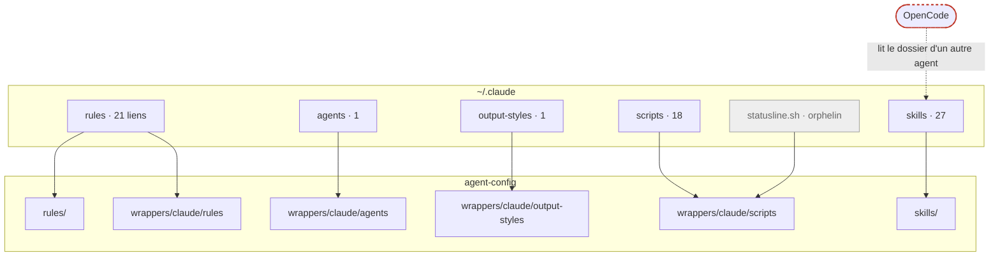
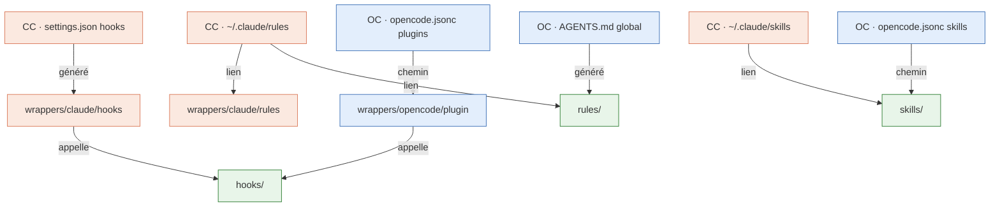

# Rapport d'analyse : harnais agnostique Claude Code / OpenCode

Analyse en lecture seule menée le 2026-10-22 sur Claude Code 2.1.308 et OpenCode v2.1.0. Aucun fichier d'`agent-config`, du vault, de `~/.claude` ni de `~/.config/opencode` n'a été modifié. Les seuls fichiers écrits pendant l'analyse sont ce rapport et des copies de doc dans un dossier temporaire.

Marquage : **mesuré** (commande lancée ici), **doc-vérifié** (doc officielle lue ce jour), **code-vérifié** (source OpenCode `anomalyco/opencode`, branche `dev`, lue ce jour), **supposé**.

Sources lues le 2026-10-22, citées plus bas par leur nom court :

| Nom court | Source |
|---|---|
| CC-memory | `code.claude.com/docs/en/memory` |
| CC-hooks | `code.claude.com/docs/en/hooks.md` |
| CC-perm | `code.claude.com/docs/en/permissions.md`, `permission-modes.md` |
| CC-env | `code.claude.com/docs/en/env-vars.md` |
| CC-cli | `code.claude.com/docs/en/cli-reference.md` |
| CC-mcp | `code.claude.com/docs/en/mcp.md` |
| OC-skills | `opencode.ai/v2/docs/skills` |
| OC-instr | `opencode.ai/v2/docs/instructions` |
| OC-config | `opencode.ai/v2/docs/config` |
| OC-plugins | `opencode.ai/v2/docs/plugins` et `/v2/docs/build/plugins` |
| OC-perm | `opencode.ai/v2/docs/permissions` |
| OC-mcp | `opencode.ai/v2/docs/mcp-servers` |
| OC-agents | `opencode.ai/v2/docs/agents`, `/v2/docs/commands` |
| OC-src | `packages/cli/src/server-process.ts` l. 120-133, `CHANGELOG.md` (v2.0.32) |
| OC-db | `~/.local/share/opencode/opencode.db`, ouverte en `mode=ro` |

---

## Q0 — Méthode de travail (verdict)

**Verdict : un worktree d'`agent-config` en dossier frère (`Workspaces/agent-config-v2`, branche `harness-v2`), testé par un banc isolé par variables d'environnement, jamais par les dossiers vivants.** Ce qui tranche, c'est que ni le worktree ni la branche ne suffisent seuls : `~/.claude` pointe vers le checkout principal (68 liens, mesuré), donc la seule façon de tester le nouveau harnais sans toucher la session en cours est de le faire charger par un agent dont la config vit ailleurs.

| Option | (1) Tester sans toucher la session | (2) Bascule et retour | (3) Découpage |
|---|---|---|---|
| **Branche dans le checkout principal** | Impossible. Un `git checkout` change sous les liens de `~/.claude` les gardes de la session en cours, et un garde introuvable bloque tous les appels `Bash` (`rules/workspaces.md`) | nul à basculer, dangereux à chaque checkout | une PR par issue |
| **Worktree frère** ✅ | Oui, avec le banc ci-dessous | merge sur `main`, puis réinstallation dans la même commande. Retour : tag `pre-v2` + ancien `sync-rules.sh --fix` | une branche par issue depuis `harness-v2`, même historique |
| **Projet frère dédié** | Oui, même banc | le plus cher : remplacer un dépôt par un autre, historique coupé, 68 liens et 72 mentions de `wrappers/claude/scripts` à reprendre | deux dépôts à synchroniser |

**Piège de bascule mesuré** : si la refonte déplace des fichiers, les liens vivants cassent à l'instant du merge. L'installation doit donc tourner dans la même commande que le `git pull`/merge, avec la liste des liens sauvegardée avant (`find ~/.claude -type l -lname '*agent-config*' -printf '%p -> %l\n'`, rejouable).

### Les lancements croisés retrouvés

| Sens | Session | Commande exacte | Résultat |
|---|---|---|---|
| Claude → OpenCode | `013b91c9` (vault, 2026-10-21) | `timeout 150 opencode run --standalone --auto "<prompt>"` | ✅ écrit et édite un fichier, le plugin `vault-log` se voit charger avec `--print-logs --log-level debug` (`msg="loading plugin"`) |
| Claude → OpenCode | `013b91c9` | plugin sonde écrit dans `.opencode/plugins/probe/` | ❌ aucun `probe.jsonl` produit, cause absente de l'extrait |
| Claude → OpenCode | `301ab296` (vault, 2026-10-20) | `timeout 170 opencode run "Lance exactement cette commande avec ton outil bash…"` | ✅ sonde d'environnement et d'ascendance de processus |
| OpenCode → Claude | `ses_ea7948f6af` (OC-db, 2026-10-20) | `claude --bg --name "test-oc" "<prompt>"` | ✅ session de fond, lue par `claude logs <id>` |
| OpenCode → Claude | idem | `claude -p --resume <id> "<prompt>"` sur une session de fond restée vide | ❌ `No conversation found` |
| OpenCode → Claude | idem | `claude -p --allowedTools "Bash(python3:*)" "<prompt>"` | ❌ le flag variadique avale le prompt. ✅ une fois le prompt placé avant l'option |
| OpenCode → Claude | idem | `claude agents` | ❌ exige un TTY, `claude agents --json` passe |
| OpenCode lit Claude | `ses_ea7998ccff` (2026-10-20) | `ls ~/.claude/skills`, `find -L … -name SKILL.md` | c'est la session où OpenCode a constaté qu'il lit `~/.claude/skills` |

Tout ceci est **mesuré** dans les transcripts. **Aucun lancement n'était isolé** : chacun tournait sur la vraie config et le vrai vault. `--standalone` n'isole que le processus serveur. Autre fait mesuré : un OpenCode lancé depuis Claude hérite de `CLAUDECODE=1`, `AI_AGENT=claude-code_…` et `CLAUDE_CODE_SESSION_ID` (session `301ab296`). Un hook qui devinerait son agent par l'environnement se tromperait donc.

**La recette sert de banc à condition d'y ajouter l'isolation** :

- **Claude** : `CLAUDE_CONFIG_DIR=$tmp claude -p "<prompt>" --output-format stream-json --verbose`. La doc dit « All settings, session history, and plugins are stored under this path » (CC-env, doc-vérifié). Deux obstacles. D'abord, les commandes de hooks de `settings.json` écrivent `~/.claude/scripts/…` en dur (mesuré), donc un banc relocalisé exécuterait les gardes du checkout principal. L'installation doit écrire le chemin résolu. Ensuite, l'authentification dans un dossier relocalisé n'est pas établie (`CLAUDE_CODE_OAUTH_TOKEN` est une piste, CC-env).
- **OpenCode** : `OPENCODE_CONFIG_DIR=$tmp OPENCODE_DISABLE_CLAUDE_CODE=1 opencode run --standalone --auto "<prompt>"` (OC-src, code-vérifié). `--standalone` est obligatoire, parce que ces variables sont lues au démarrage du serveur et que le service de fond ne les verrait pas.
- **Preuve de chargement, déterministe** : côté OpenCode, la table `instruction_state` d'OC-db liste par session les clés `core/instructions` (chemins des fichiers d'instructions) et `core/skill-guidance` (skills exposés), mesuré ici. Côté Claude, l'appel à l'outil `Skill` dans le transcript, méthode déjà calibrée par `run-skill-evals.py` (README), et un hook `InstructionsLoaded` pour les rules (le vault en a un).

### AIDD pour ce chantier

`agent-config` ne porte pas d'`aidd_docs/` (mesuré), donc le déclencheur « Chercher un skill avant d'agir » de `rules/aidd.md` ne s'applique pas. Deux skills restent utiles sans être obligatoires : `aidd-vcs:04-issue-create` pour créer les issues du découpage, et ton skill `cadre-prompt` pour cadrer chaque prompt d'exécution. `aidd-orchestrator:01-sdlc` ne convient pas ici : il pousse et ouvre une PR seul, alors que chaque bascule demande ton accord.

---

## Q1 — Structure cible

### Base vierge

```
agent-config/
  rules/                 # prose agnostique, frontmatter neutre
  skills/                # format Agent Skills (name, description)
  hooks/                 # cœur des gardes : décision pure, entrée normalisée
  policy/deny.yaml       # interdictions déclarées une fois
  mcp/servers.yaml       # serveurs MCP déclarés une fois
  agents/                # sous-agents, corps neutre + métadonnées communes
  tools/                 # outillage du harnais : install, lint, évals, mesures, CI
    drivers/<agent>.py   # lancer une session, lire ses transcripts
  wrappers/<agent>/
    manifest.yaml        # quoi va où, lien ou généré
    rules/               # rules propres à l'agent
    hooks/               # adaptateurs d'entrée/sortie vers hooks/
    templates/           # fragments de settings.json, opencode.jsonc
```

**Contrat du cœur des hooks** : une commande lit `{event, action: shell|edit|read, command, paths, cwd, session}` sur stdin et répond `exit 0` pour laisser passer, `exit 2` + raison sur stderr pour refuser. C'est déjà le contrat de `scripts/garden-locked.sh` dans le vault (mesuré).

**Installation sans chemin en dur** : `tools/install.py --agent claude --target "${CLAUDE_CONFIG_DIR:-$HOME/.claude}" [--check|--fix]` dérive la racine du repo de son propre emplacement, comme `sync-rules.sh` le fait déjà (l. 30). Les liens portent un chemin absolu calculé à l'installation, jamais écrit dans le repo. Les commandes de hooks sont générées avec ce même chemin.

**Un troisième agent sans toucher au cœur** : ajouter `wrappers/codex/` (manifest, adaptateur de hooks, gabarits) et `tools/drivers/codex.py`. Rien ne change dans `rules/`, `skills/`, `hooks/`, `policy/`, `mcp/` tant que le contrat du cœur des hooks reste normalisé.

### Comparaison à l'existant

| Pièce | Existant | Cible | Décision |
|---|---|---|---|
| `rules/`, `skills/` à la racine | oui | oui | **garder**. Un renommage en `core/` déplacerait 68 liens sans rien apporter de mesurable |
| logique des gardes | dans `wrappers/claude/scripts/hooks` | `hooks/` | **déplacer** la décision, laisser l'entrée/sortie dans le wrapper |
| outillage (lint, CI, évals) | dans `wrappers/claude/scripts` | `tools/` | **déplacer**. `check-ci-contract.py`, `lint-skills.py`, `lint-html-prose.py`, `apply-ci-ruleset.sh` ont 0 marqueur Claude (mesuré). Coût : 72 mentions dans 37 fichiers |
| installation | `sync-rules.sh` + liens posés à la main | `tools/install.py` + manifest par agent | **remplacer**, après parité mesurée |
| règle de placement du README | « ça échoue, ou ça dégrade sans casse ? » | même critère | **garder**, c'est le bon test |

### La lecture de `~/.claude` par OpenCode

**Verdict : un repli à tolérer, pas un appui.** Mesuré dans OC-db : les sessions lancées dans `~` exposent 23 skills, dont les 12 skills auto-invocables d'`agent-config`, 9 skills claude.ai synchronisés sous `~/.claude/skills/synced/` et 2 skills livrés avec OpenCode (`opencode`, `report`, supposé). Aucune de ces sessions n'a de `core/instructions`, donc ni `~/.claude/rules` ni `~/.claude/CLAUDE.md` ne sont chargés. Le code le confirme : « `.claude` is only read for skills » (OC-src, code-vérifié). Les liens symboliques sont suivis et la recherche descend au moins de trois niveaux (mesuré, `synced/<bucket>/<skill>`). La cible déclare donc `skills: ["<repo>/skills"]` dans la config OpenCode générée, et pose `OPENCODE_DISABLE_CLAUDE_CODE_SKILLS=1` si tu ne veux plus des skills claude.ai sous OpenCode (arbitrage à toi).

---

## Q1bis — Wrappers et liens symboliques

**Chaque `wrappers/<agent>` reste nécessaire** : settings, gabarits de config et adaptateurs de hooks n'ont pas d'équivalent commun (Q2, Q5).

| Élément de `wrappers/claude` | Verdict | Mesure |
|---|---|---|
| `settings.json` | propre à Claude | clés Claude seulement, et chemins `~/.claude/scripts` à générer |
| `rules/plan-mode.md`, `rules/memory-policy.md` | propre à Claude | `EnterPlanMode`, auto-memory |
| `agents/doc-writer.md` | **partagé de fait** | corps à 0 marqueur Claude. Seul le frontmatter diffère : OpenCode attend `description`, `mode` (OC-agents) |
| `output-styles/chat-style.md` | **inutile en l'état** | `outputStyle` vaut `"Concise"`, le style n'est sélectionné nulle part |
| `scripts/hooks/guard-*.py`, `.sh` | **scinder** | décision vers `hooks/`, lecture de `tool_input` et sortie `hookSpecificOutput` dans le wrapper |
| `scripts/hooks/init-codegraph.py` | partagé de fait | ne lit que `cwd` |
| `scripts/aidd-updates.py` | propre à Claude | détecte les versions des plugins Claude d'AIDD |
| `check-ci-contract.py`, `apply-ci-ruleset.sh`, `lint-*.py` | partagés de fait | 0 marqueur |
| `run-skill-evals.py`, `mesure-reponses.py` | **scinder** | le lanceur `claude -p` et la lecture de `~/.claude/projects` vont dans un driver |
| `statusline.sh` | propre à Claude | pas d'équivalent dans la doc v2 lue |
| `sync-rules.sh`, `sync-settings.py` | remplacés par `tools/install.py` | même logique d'écart, échoue fermé |
| lien `~/.claude/statusline.sh` | **inutile** | aucune référence dans `settings.json` ni dans le repo (mesuré) |

### Graphe actuel (mesuré)



Deux croisements. OpenCode lit `~/.claude/skills`, le dossier d'un autre agent. Les outils neutres (lint, CI) ne s'atteignent que par `wrappers/claude/scripts`. Côté vault, deux liens relatifs supplémentaires : `.claude/skills` et `.claude/rules` pointent vers `.agents/`. OpenCode y lit `.agents/skills` et `.claude/skills`, donc le même dossier deux fois, sans doublon dans la liste exposée (37 skills uniques, mesuré).

### Graphe minimal proposé



Un seul sens, du dossier de l'agent vers le cœur. Aucun agent ne lit le dossier d'un autre.

**Lien, génération ou copie** :

| Cible | Mécanisme | Pourquoi | Coût à la bascule |
|---|---|---|---|
| skills, rules de Claude | lien par entrée | Claude lit le format tel quel, et un fichier lié se corrige sans rebuild | nul, c'est l'existant |
| `AGENTS.md` global d'OpenCode | **généré** | un seul fichier fait de plusieurs rules, sans `paths:` (Q4) | une étape de build à rejouer après chaque edit, que `--check` doit attraper |
| `settings.json`, `opencode.jsonc` | **fusion de clés** | les deux agents y écrivent eux-mêmes (constaté pour Claude, README) | reprise de `sync-settings.py`, déjà calibré |
| copie | jamais | une copie diverge sans signal | — |

---

## Q2 — Hooks

| Hook | Événement CC | Entrée / sortie CC | Équivalent OpenCode | Part portable |
|---|---|---|---|---|
| `guard-no-claude-in-commit.sh` | `PreToolUse` | `tool_input.command`, `cwd`. Refus en `hookSpecificOutput.permissionDecision: deny` | `ctx.permission.hook("evaluate")` sur `action: shell`, `effect = "deny"` + `message` | l'analyse du message de commit (l. 27-389). Le contrôle de `~/.claude/settings.json` reste propre à Claude |
| `guard-bash-tooling.py` | `PreToolUse` | idem, double forme de sortie | `evaluate` sur `shell` | `analyse()`, `tokenize()` |
| `guard-no-remote-write.py` | `PreToolUse` | `tool_input.command` ou chemin. Sortie `decision: block`, forme dépréciée pour cet événement (CC-hooks) | `evaluate` sur `shell` et `edit` | `classify()`, `check_path()` |
| `guard-aidd-skill-lookup.py` | `PreToolUse` | lit `transcript_path` pour savoir si un skill AIDD a tourné | `evaluate` ne fournit pas de transcript, mais il reçoit aussi `action: skill`, donc le plugin peut tenir en mémoire les skills chargés par session (supposé) | `gesture()`. Le fournisseur « skill déjà utilisé » est propre à chaque agent |
| `init-codegraph.py` | `SessionStart` (`startup`) | `cwd` | `setup()` du plugin, une fois par serveur et par dossier, pas par session (mesuré par AIDD dans son pont) | tout |
| `aidd-updates.py --notify` | `SessionStart` | `additionalContext` | `session.hook("context")` pousse du système à chaque appel modèle, sans persister (OC-plugins). Il faudrait dédupliquer | rien, le détecteur vise les plugins Claude |
| `codegraph prompt-hook` (machine) | `UserPromptSubmit` | contexte ajouté | `codegraph install` n'écrit que le MCP pour OpenCode (`--print-config opencode`, mesuré) | hors repo |
| vault `block-garden-writes.sh` | `PreToolUse Edit\|Write` | `tool_input.file_path` | **existe déjà** : `garden-guard` sur `permission.evaluate`, `action: edit` | `scripts/garden-locked.sh` |
| vault `log-file-change.sh` | `PostToolUse` | JSON Claude | **existe déjà** : `vault-log` sur `tool.hook("execute.after")` | `scripts/log_event.py` |
| vault `log-instructions-loaded.sh` | `InstructionsLoaded` | — | aucun événement documenté | — |

Toutes les lignes CC sont doc-vérifiées (CC-hooks) et mesurées dans les scripts. Les lignes OC sont doc-vérifiées (OC-plugins).

**Le modèle hexagonal tient, et il est déjà éprouvé** : ton hypothèse « les hooks OpenCode réutilisent des scripts partagés » est **vraie, mesurée**. `garden-guard/index.ts` appelle `scripts/garden-locked.sh` et `vault-log/index.ts` appelle `scripts/log-opencode-change.sh`, eux-mêmes sur `log_event.py`. Il reste deux écarts à porter dans le cœur. Un `deny` configuré est final et n'appelle pas le hook `evaluate`, donc la politique déclarative passe d'abord (OC-plugins). Et un `spawnSync` par évaluation coûte un processus, d'où le filtre par préfixe avant tout appel, comme le fait déjà `garden-guard`.

**Mesuré : les gardes refusent bien en mode bypass.** Les transcripts portent 12 refus réels du garde de commit dans des sessions `bypassPermissions` (sessions `4741d94d` du 2026-10-08 et `280bd9b4` du 2026-10-12).

---

## Q3 — Skills

Mesuré dans OC-db : OpenCode expose les skills d'`agent-config` sans aucun réglage, par `~/.claude/skills`. Les 14 skills qui portent `disable-model-invocation: true` sont absents de la liste du modèle, ce qui suit la doc : « Set to `true` for the same effect as `opencode/autoinvoke: false` » (OC-skills).

| Champ | Claude Code | OpenCode v2 | Décision |
|---|---|---|---|
| `name`, `description` | lus | lus | cœur |
| `disable-model-invocation` | lu | lu (OC-skills) | cœur, 14 skills |
| `argument-hint` | lu, 26 skills | non mentionné, « All frontmatter is optional at runtime » | cœur. Ignoré sans dommage (supposé) |
| champs propres à OpenCode | — | sous `metadata` (`opencode/autoinvoke`, `opencode/slash`) | cœur, sous `metadata` seulement |
| invocation manuelle | `/nom` | `@skill-id` (OC-skills) | à noter dans les skills qui citent la forme `/nom` |

**Skills qui restent propres à un agent** (mesuré par grep de `~/.claude`, `claude -p`) : `harness-sync`, qui gère liens et settings Claude, et `aidd-updates`, détecteur de plugins Claude. Quatre autres citent un chemin `~/.claude` à paramétrer sans être propres à Claude : `doc-sync`, `dev-tech-comparison`, `skill-craft` (hors périmètre) et `research-kit/INSTALL.md`.

**Découverte cible** : Claude par liens dans `~/.claude/skills`, OpenCode par `skills: ["<repo>/skills"]` dans sa config générée.

---

## Q4 — Rules

**Critère de tri, deux questions dans l'ordre** :

1. La consigne nomme-t-elle un mécanisme d'un seul agent (outil, événement, dossier) sans lequel elle n'a plus d'objet ? Si oui, elle est **propre à l'agent**.
2. Sa raison d'être est-elle la mesure d'un comportement d'un modèle ou d'un harnais précis, qui peut disparaître si on change de modèle ? Si oui, c'est un **calage**, à re-mesurer avant de le servir à un autre modèle.

Sinon, elle est **essentielle**.

| Fichier | Mots | Catégorie | Note |
|---|---|---|---|
| `reasoning.md` | 1 207 | essentielle | la référence à « la page Opus 5 » justifie, elle ne cale pas |
| `ai-principles.md` | 468 | essentielle, **avec deux principes calés** | deux principes sont « réduits à leur titre » parce que le system prompt de Claude Code porte le geste. Sous OpenCode, ce prompt n'existe pas, donc il faut leur rendre leur texte |
| `autorite-des-conventions.md`, `commit-convention.md`, `workspaces.md`, `aidd.md`, `mermaid.md` | 2 371 | essentielles | la section « Déplacer un projet existant » de `workspaces.md` décrit les liens de `~/.claude` et passe à l'adaptateur |
| `style.md`, `profil.md`, `reponse.md`, `redaction.md` | 1 453 | essentielles (voix de l'opérateur) | agnostiques |
| `ponctuation.md` | 351 | **calage** | fondée sur 5,25 points-virgules pour 1 000 mots mesurés sur des recaps Claude. `mesure-reponses.py` ne lit que les transcripts Claude, donc à re-mesurer sous MiniMax et DeepSeek avant de la garder pour eux |
| `skill-description.md` | 259 | essentielle, un paragraphe calé | l'échappement des chevrons est constaté en Claude Code 2.1.300 |
| `codegraph.md` | 288 | essentielle, un paragraphe propre à Claude | le hook `UserPromptSubmit` |
| `tooling.md` | 119 | essentielle | sous OpenCode, sans garde porté, la prose devient la seule couche |
| `back-spring.md`, `backend-api.md`, `front-react.md`, `frontend-design.md` | 1 062 | essentielles, **scopées** | voir `paths:` ci-dessous |
| `plan-mode.md` | 530 | propre à Claude | `EnterPlanMode`. OpenCode a un agent primaire `plan` en lecture seule (`opencode debug agents`, mesuré), une autre forme de la même porte |
| `memory-policy.md` | 184 | propre à Claude | l'auto-memory n'a pas d'équivalent documenté sous OpenCode |

Une mesure par catégorie. Pour les essentielles, `commit-convention.md` est tenue par un garde qui a refusé 12 fois en bypass, ce qui prouve que la règle sert. Pour les calages, les deux mentions « Réduit à son titre » d'`ai-principles.md` et la mesure de `ponctuation.md`. Pour le propre à Claude, 15 références Claude Code dans `plan-mode.md`.

**OpenCode charge-t-il des rules ?** Pas depuis `~/.claude/rules` : mesuré (aucun `core/instructions` hors vault) et code-vérifié. Ses seules sources sont `~/.config/opencode/AGENTS.md`, les `AGENTS.md` du dossier courant en remontant, et le tableau `instructions` (OC-instr, doc-vérifié). Il n'a ni `CLAUDE.md` en repli, ni dossier de rules.

**Le scope `paths:` disparaît sous OpenCode** : aucun mécanisme de scope par chemin n'est documenté (OC-instr), et la spec AIDD du 2026-10-08 dit « Never claim native glob-based rule scoping from OpenCode V2 ». Trois sorties possibles pour les 1 062 mots scopés : les charger toujours, les transformer en skills, ou les réécrire en phrase (« s'applique aux fichiers Java »). Recommandation : la phrase dans l'`AGENTS.md` généré, parce que c'est la seule qui garde la règle présente sans changer son mode de déclenchement sous Claude.

---

## Q5 — Permissions

| | Claude Code | OpenCode v2 |
|---|---|---|
| Mode permissif | `--dangerously-skip-permissions`, qui vaut `bypassPermissions` (CC-cli) | `--auto` : « Auto-approve permissions that are not explicitly denied » (`opencode run --help`, mesuré) |
| Ce qui tient en mode permissif | les hooks `PreToolUse` : 12 refus mesurés en bypass. Les règles `ask` et les suppressions critiques `rm` (CC-perm). Les règles `deny` en bypass : la doc ne le dit pas explicitement, **supposé** | les `deny` configurés : « configured `deny` rules always remain enforced ». Les `policies` refusent par-dessus tout, et une politique globale passe devant le projet (OC-perm) |
| Où ça se déclare | `permissions.deny` dans `settings.json`, hooks `PreToolUse` | `permissions` (le dernier qui correspond gagne), `policies`, plugin `permission.evaluate` |
| Défaut constaté | la machine n'a qu'un bloc `allow` (mesuré) | l'agent `build` demande pour `*.env` (mesuré) |

**Interdictions à garder malgré le bypass** : mention d'IA et format de commit, écriture sur preprod/prod, `java`/`mvnw` hors `bash -lc 'sh ./mvnw'` et heredoc imbriqué, lecture des fichiers de secrets (`~/.config/opencode/service.json`, `~/.claude/.credentials.json`, `.env`).

**Les écrire une fois** : `policy/deny.yaml`, chaque entrée portant `{id, action: shell|edit|read, motif, raison, tenue: règle|garde}`. Le générateur produit `permissions.deny` pour Claude et `policies` pour OpenCode quand un motif suffit. Ce qui demande d'analyser une commande reste un garde du cœur. Un `deny` Claude ne reconnaît pas le programme appelé par chemin ni dans un `sh -c` (CC-perm), donc les gardes restent la couche forte.

---

## Q6 — Plugins : AIDD sous OpenCode

AIDD n'arrive pas sous OpenCode par un plugin, mais par sa CLI, qui génère des fichiers dans le projet. Le README d'AIDD classe OpenCode « ✅ Supported | Flat », installé en dézippant l'archive `opencode-flat` dans `.opencode/` (mesuré dans `~/.claude/plugins/marketplaces/aidd-framework/README.md`). La CLI v5.5.0 du 2026-10-16 porte un profil `opencode` qui convertit agents, skills, commandes, rules, MCP et plugins.

**Limites, mesurées dans le code d'AIDD** :

- Le pont de hooks ne rejoue que 3 événements : `SessionStart`, `Stop`, `PostToolUse`. Il n'y a **pas de `PreToolUse`**, donc aucun garde AIDD ne bloque sous OpenCode.
- Les rules passent par `AGENTS.md`. La spec du 2026-10-08 vise la v2 seulement, et y écrit que « configuration.instructions does not activate rule files », ce qui contredit OC-instr (voir « Non établi »).
- L'installation est par projet. Claude, lui, installe les plugins au niveau utilisateur.

**Ce qui n'est pas portable** : la marketplace et `enabledPlugins`, le détecteur `aidd-updates.py`, `${CLAUDE_PLUGIN_ROOT}`, et l'espace de noms `aidd-dev:…` des skills, que le mode flat aplatit (supposé). Ce dernier point touche les 16 noms de skills AIDD cités dans ce repo.

---

## Q7 — MCP

| | Claude Code | OpenCode v2 |
|---|---|---|
| Où | `~/.claude.json` (portée user), `.mcp.json` (projet), `--mcp-config` (CC-mcp) | `mcp.servers` dans `~/.config/opencode/opencode.jsonc` ou projet (OC-mcp) |
| Forme | `{type: stdio, command, args}` | `{type: local, command: [..], environment}`, variables en `{env:NAME}` |
| État actuel | `codegraph` en portée user (mesuré) | rien, il n'y a pas de `opencode.json` (mesuré) |

**Déclarer une fois** : `mcp/servers.yaml` déclare `{nom, commande, env}`. Le générateur écrit la forme de chaque agent. Pour un serveur qui fournit son installateur, le cœur délègue : `codegraph install -t claude,opencode -l global -y` sait viser les deux agents (`codegraph install --help`, mesuré). `~/.claude.json` est un fichier machine, comme `settings.json`, donc il se fusionne et ne se lie pas.

---

## Q8 — AGENTS.md

**Claude Code 2.1.308 lit `AGENTS.md` nativement** : il faut la 2.1.277 ou plus (CC-memory, doc-vérifié). Il ne le lit que s'il n'existe aucun `CLAUDE.md` ni `CLAUDE.local.md` dans le dossier courant ou au-dessus. `~/.claude/CLAUDE.md` et `.claude/rules/` n'empêchent pas cette lecture. Le réglage `claude-md-and-agents-md` lit les deux.

**`CLAUDE.md` ne devient pas inutile.** Sans lui, on perd trois choses. Les hooks `InstructionsLoaded`, qui ne se déclenchent pas pour un `AGENTS.md` lu par le réglage, alors que le vault s'en sert. Le chargement d'un `CLAUDE.md` depuis les dossiers `--add-dir`. Et la demande d'accord pour les imports externes. Les imports `@path` restent développés dans `AGENTS.md`. Le scope `paths:` relève de `.claude/rules/`, pas de `CLAUDE.md`, donc il ne bouge pas.

**OpenCode v2 lit `AGENTS.md` seulement**, sans `CLAUDE.md` en repli (OC-instr). Son global est `~/.config/opencode/AGENTS.md`.

**Forme cible, déjà en place dans le vault** (mesuré) : `AGENTS.md` porte le commun, `CLAUDE.md` commence par `@AGENTS.md` puis ajoute « Spécifique Claude Code ».

---

## Q9 — Trous du brouillon qui changent le découpage

| Trou | Ce qui est établi | Effet sur le découpage |
|---|---|---|
| Chemins `~/.claude/scripts` en dur dans `settings.json` | mesuré | **bloque le banc** : à générer avant tout test isolé (tâche 2) |
| Sous-agents | `doc-writer` neutre, frontmatter à convertir (OC-agents) | entre dans l'installateur |
| Commandes slash | Claude : skills. OpenCode : `~/.config/opencode/commands/`, `$ARGUMENTS` (OC-agents) | aucune commande dans le repo, rien à porter |
| Output styles | `chat-style.md` non sélectionné. OpenCode : le corps d'un agent primaire tient lieu de prompt système (supposé) | supprimer ou garder, à trancher |
| Statusline | Claude seulement | reste dans le wrapper |
| Mémoire | auto-memory propre à Claude | `memory-policy.md` reste dans le wrapper |
| Modèle et effort | Claude : `model`, `effortLevel`. OpenCode : `provider/model#variant` par agent (OC-agents) | le cœur déclare des rôles (plan, exécution, revue), chaque gabarit les traduit. Le choix des modèles reste hors périmètre |
| Synchronisation des settings | `sync-settings.py` fusionne sans retirer les hooks machine (`MessageDisplay`, `UserPromptSubmit`) | modèle à reprendre pour `opencode.jsonc` |
| Tests et lint du harnais | `lint-skills.py` neutre. `run-skill-evals.py` lié à `claude -p`. Batteries de hooks au format Claude | driver par agent, batterie du cœur sur l'entrée normalisée |
| Secrets | `service.json`, table `credential` d'OC-db, `.credentials.json`. MCP en `{env:NAME}` sous OpenCode | entrée de `policy/deny.yaml` |
| Environnement du service OpenCode | `SKILLS_ROOT` et `OBSIDIAN_VAULT_PERSO` viennent du `.zshrc` (README). Le service de fond les voit-il ? | à mesurer dans le banc avant de porter `_shared/` |

---

## Matrice de parité

| Domaine | Claude Code 2.1.308 | OpenCode v2.1.0 | Ce que l'adaptateur porte |
|---|---|---|---|
| Hooks | `settings.json`, commande, JSON sur stdin, refus par `exit 2` ou `permissionDecision` | plugin TypeScript, `permission.evaluate`, `tool.execute.before/after`, `session.*` | un shim par agent vers `hooks/` |
| Skills | `~/.claude/skills`, liens suivis | `~/.config/opencode/skills`, `skills: [...]`, et en repli `~/.claude/skills` | un chemin dans la config générée |
| Rules | `~/.claude/rules`, récursif, `paths:` | aucun dossier. `AGENTS.md` global et projet, `instructions` | un `AGENTS.md` généré, `paths:` réécrit en phrase |
| Permissions | `permissions.deny/ask/allow`, hooks plus forts que le bypass | `permissions` (dernier qui correspond), `policies` en refus dur | générés depuis `policy/deny.yaml` |
| Plugins | marketplace, `enabledPlugins`, `hooks/hooks.json` | `plugins` (npm, git, dossier), `.opencode/plugins/` | AIDD par sa CLI, mode flat |
| MCP | `~/.claude.json`, `.mcp.json` | `mcp.servers` dans `opencode.jsonc` | généré depuis `mcp/servers.yaml`, ou installateur du serveur |
| AGENTS.md | lu sans `CLAUDE.md` (≥ 2.1.277) | seul fichier d'instructions | `CLAUDE.md` commence par `@AGENTS.md` |

---

## Hors contrat

- `guard-no-remote-write.py` répond `decision: block`, forme dépréciée pour `PreToolUse` mais encore traduite (CC-hooks).
- `sync-rules.sh` et `sync-settings.py` renvoient à `rules/workflow.md`, qui n'existe pas (mesuré).
- Le README annonce « Trois hooks `PreToolUse` » et en liste quatre.
- `plan-mode.md` dit qu'en plan mode « l'édition devient impossible ». La doc dit qu'en session interactive avec bypass disponible, Claude Code n'applique pas les blocages du plan mode (CC-perm, « Skip all checks »).
- Le vault avait déjà `TODO.md` modifié avant cette analyse. Ce n'est pas de mon fait.
- `video-brief` et `total-war-strategist` sont absents de la liste d'OpenCode sans porter `disable-model-invocation`. Cause non cherchée.

## Non établi

- **Effet réel du tableau `instructions` d'OpenCode** : OC-instr le décrit, la spec AIDD du 2026-10-08 dit qu'il n'active pas les fichiers de rules. Il manque un passage au banc, avec lecture de `core/instructions` dans OC-db.
- **Authentification d'un Claude relocalisé par `CLAUDE_CONFIG_DIR`** : la page sur les identifiants n'a pas été lue.
- **Règles `deny` de Claude en `bypassPermissions`** : la doc ne le tranche pas explicitement. Il manque un `claude -p` en bypass contre une règle `deny` jetable, dans le banc.
- **Dédoublonnage d'OpenCode** quand le même skill vient de deux sources : observé sans doublon dans le vault, source non lue.
- **Variables d'environnement vues par le service OpenCode de fond.**
- **Équivalents OpenCode de la statusline et des output styles** : absents des pages v2 lues, mais la doc v2 n'a pas de sommaire complet.
- **Cause de l'échec du plugin sonde** du 2026-10-21.

---

## Découpage en tâches ordonnées

L'ordre suit une contrainte : on ne déplace rien avant d'avoir un banc qui prouve la parité.

| # | Tâche | Effet vérifiable |
|---|---|---|
| 1 | Worktree `agent-config-v2`, tag `pre-v2`, sauvegarde de la liste des liens | `git worktree list` montre les deux. `find ~/.claude -type l …` est identique avant et après |
| 2 | `tools/install.py --agent claude --target DIR --check/--fix`, chemins de hooks générés | `--check` sur le vrai `~/.claude` rend 0 écart, sans rien écrire (parité avec l'existant) |
| 3 | Banc isolé `tools/bench.sh claude\|opencode`, sur `CLAUDE_CONFIG_DIR` et `OPENCODE_CONFIG_DIR` + `--standalone` | une commande rend la liste des skills et rules chargés par le worktree. `~/.claude` reste inchangé |
| 4 | Restructuration : `hooks/`, `tools/`, wrappers allégés, 72 mentions mises à jour | le banc Claude rend 21 rules, 27 skills et 4 gardes actifs. Les 10 batteries de tests passent |
| 5 | Cœur des gardes sur entrée normalisée, shims Claude | batteries Claude inchangées et vertes, plus une batterie du cœur sur l'entrée normalisée |
| 6 | Plugin OpenCode `harness-guards` sur `permission.evaluate` | dans le banc OC, `git commit -m "fix: Claude"` est refusé avec la raison du garde |
| 7 | Skills OpenCode servis par `skills: [...]`, arbitrage sur les skills claude.ai | `core/skill-guidance` du banc liste les 12 skills auto-invocables d'`agent-config` avec `OPENCODE_DISABLE_CLAUDE_CODE=1` |
| 8 | `AGENTS.md` global généré depuis `rules/`, `paths:` en phrase, deux principes d'`ai-principles.md` rendus à leur texte | `core/instructions` du banc contient le fichier généré. Tranche aussi la question `instructions` |
| 9 | `policy/deny.yaml` et génération des deux formes | la lecture de `service.json` est refusée dans les deux bancs |
| 10 | `mcp/servers.yaml` et délégation à `codegraph install` | l'outil `codegraph_explore` est disponible dans les deux bancs |
| 11 | Drivers OpenCode pour `run-skill-evals.py` et `mesure-reponses.py`, puis re-mesure de `ponctuation.md` | un cas d'éval joué sous OpenCode rend un verdict. Le taux de points-virgules est connu par modèle |
| 12 | AIDD sous OpenCode : installation flat sur un projet test | un skill AIDD apparaît dans `core/skill-guidance` d'une session du projet test |
| 13 | Bascule : merge et installation en une commande, retour arrière documenté | `install.py --check` rend 0 écart sur `~/.claude` et `~/.config/opencode`. Une session neuve de chaque agent charge le nouveau harnais |

Chaque tâche se cadre ensuite par `cadre-prompt`, et peut devenir une issue via `aidd-vcs:04-issue-create`.

## Provenance

- Prompt de cadrage : note de vault `0 INBOX/2026-10-22-prompt-harnais-agnostique-analyse.md`.
- Analyse en lecture seule : `git status` d'`agent-config` était vide à la fin de l'analyse. Dans le vault, `TODO.md` était déjà modifié avant l'analyse.
