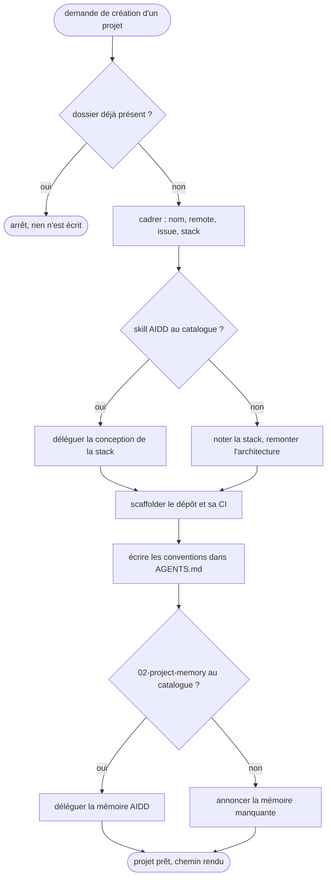

# dev-init-project — créer un projet et capturer ses conventions

Crée l'ossature d'un projet neuf sous `~/Developpement/Workspaces`, avec les conventions que le code ne dira jamais. Rend la main dès que le projet existe, que son `AGENTS.md` porte ses conventions et que sa mémoire AIDD est amorcée ou son absence annoncée.

## Process

1. **Garde sur le dossier.** Vérifier que le dossier du projet n'existe pas déjà sous `~/Developpement/Workspaces`, avant toute écriture.
   - Déjà présent : rendre son chemin et s'arrêter là, sans rien créer.
   - `rules/workspaces.md` interdit de créer ou de cloner par-dessus un projet existant, il n'y a rien à récupérer.
2. **Cadrer.** Poser d'un seul bloc les questions que les skills AIDD ne posent pas.
   - Le nom du projet, et le remote : une URL, ou « aucun ».
   - L'issue de départ, quand le remote en a une.
   - La stack, si elle est déjà décidée.
   - **Garde.** Ne pas demander l'objectif, les contraintes, ni le choix d'architecture : `aidd-context:01-bootstrap` les pose à l'étape suivante, et une question posée deux fois se répond deux fois.
3. **Concevoir la stack.** Déléguer au skill AIDD quand le catalogue de la session le porte, sinon remonter la question à l'utilisateur.
   - Délégué, il rend un `INSTALL.md`, qui reste dans le projet.
   - Absent, la stack retenue se note dans l'`AGENTS.md` et l'architecture n'est pas inventée.
   - **Garde.** Ne jamais fabriquer un `INSTALL.md` de mémoire : son gabarit appartient au skill AIDD.
4. **Scaffolder.** Créer le dossier, `git init`, l'arborescence de la stack, le `.gitignore` et la CI.
   - Poser le remote avec `git remote add`, jamais avec `gh repo create` : créer un dépôt distant écrit sur le réseau.
   - La CI se mesure avec `tools/check-ci-contract.py` du repo `agent-config`, dont le contrat vit dans `rules/references/ref-ci-github.md`.
5. **Écrire les conventions.** Remplir l'`AGENTS.md` du projet, et rien d'autre.
   - **Stack** : une ligne, qui dit quelles règles d'`agent-config/rules/` s'appliquent au projet.
   - **Conventions** : ce qui varie d'un projet à l'autre et que le code ne dit pas, ports, bibliothèque de test, nommage des paquets, langue des documents, stratégie de branches.
   - **Écarts** : une ligne par écart assumé à une règle d'`agent-config/rules/`, avec sa raison.
   - **Garde.** Ne recopier aucune règle d'`agent-config/rules/` : elle est déjà chargée dans chaque session, et une copie périme sans que rien ne le signale.
6. **Amorcer la mémoire.** Déléguer à `aidd-context:02-project-memory` quand il est au catalogue, sinon annoncer qu'elle manque.
   - Il commence par scanner le projet, donc il tourne après le scaffold.
   - Absent du catalogue, ne pas fabriquer d'arborescence `aidd_docs/` à sa place.
7. **Rendre.** Donner le chemin du projet, la stack, les conventions retenues, et ce qui n'a pas pu être fait.

## Transversal rules

- **L'`AGENTS.md` du projet n'a qu'un écrivain** : ce skill. `aidd-context:02-project-memory` possède `aidd_docs/memory/` et n'y touche pas.
- **Aucun geste réseau.** Ni création de dépôt distant, ni push. Rien ne les garde : mesuré le 2026-11-04, `hooks/no_remote_write.py` laisse passer `gh repo create` et `git push` vers GitHub, il ne couvre que les serveurs preprod et prod. La règle tient à l'instruction du skill seule.
- **Son effet de bord est local et assumé.** Le skill écrit hors de tout dépôt git, donc il se déclenche au flair malgré R13. Ce qui reste possible est un dossier de trop, que `rm -rf` rattrape.
- **Aucune stack supposée.** La convention propre à Java, Node ou Python se lit dans `agent-config/rules/`, jamais de mémoire.
- **Ce qui n'est pas inférable se demande, jamais ne se devine.** Un port, une bibliothèque de test, une licence : une question, pas une valeur par défaut silencieuse.

## Test

Le déclenchement se joue outils coupés. L'effet, lui, se relit à la main : le skill crée des dossiers et un dépôt hors de celui-ci.

| Cas | Preuve |
| --- | --- |
| `python3 tools/lint-skills.py --skill dev-init-project` | rend 0, « 1/1 skills conformes » |
| `python3 -c "import json; json.load(open('skills/dev-init-project/evals/eval.json'))"` | parse, chaque cas portant `skill` et `query` |
| relecture du corpus d'évals contre R7 | un cas positif, et un négatif par frère cité dans la clause NE PAS |
| première création réelle d'un projet | son `AGENTS.md` ne contient aucune règle recopiée d'`agent-config/rules/`, et son `aidd_docs/memory/` existe ou son absence est annoncée |
