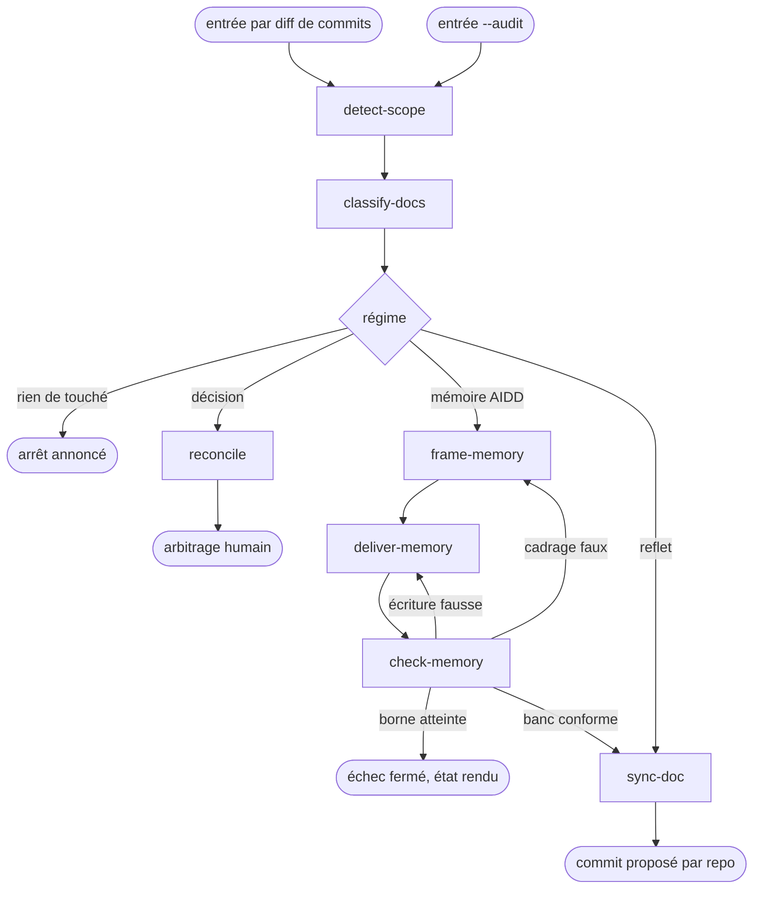

# doc-sync

Remet les README et la mémoire AIDD au niveau du code commité, dans un repo AIDD comme ailleurs, et rend la main dès qu'un arbitrage humain est nécessaire. La doc inline (Javadoc, docstring) n'en fait pas partie : elle se rafraîchit à chaud avec l'agent `doc-writer`.

## Actions

Dérouler le flux. Ne lire que la prochaine action.

| Action | Fait |
| --- | --- |
| detect-scope | choisit l'entrée, détecte la topologie, fait confirmer le scope |
| classify-docs | donne à chaque document un type et un régime, et route |
| frame-memory | décide ce qui mérite d'exister en mémoire, sans rien écrire |
| deliver-memory | écrit le plan cadré, par `/10-learn` ou en édition directe |
| check-memory | fait juger la mémoire par un checker neuf et route ses constats |
| sync-doc | réécrit les documents reflet selon leur type, après validation |
| reconcile | compare un document de décision au code et signale l'écart |

## Transversal rules

- **La doc ne couvre que le validé.** Le scope est un range de commits, jamais le working tree, sauf opt-in explicite et averti.
- **L'artefact de scope porte l'état d'une action à l'autre** : `$(git rev-parse --git-dir)/doc-sync/scope.md`, hors de l'arbre versionné. Chaque action le lit et le complète au lieu de compter sur le contexte.
- **Rien ne s'écrit sans validation, document par document.** Le commit est proposé, jamais lancé sans accord.
- **Un document de régime décision ne s'écrit jamais ici.** Il passe par `reconcile`, qui signale.
- **Un sous-agent reçoit son instrument dans son prompt.** Une question de symbole (classe, appelants) va à l'outil de symboles du projet, une question de texte (SQL, clé de config, URL, CI) va à `grep`. Un zéro d'un outil de graphe se calibre sur un symbole connu avant de se lire comme une absence. *Pourquoi : le harnais ne transmet au sous-agent que les noms des outils MCP, pas leurs descriptions (vérifié le 2026-08-27).*

## References

- `references/regimes.md` — les trois régimes, qui fait foi, et le cas qui se classe mal
- `references/memory-criteria.md` — ce qui mérite d'exister dans une mémoire AIDD
- `references/types/readme.md` — les règles d'un README, et le frontmatter que lit `check-doc.py`

## Test

Le contrôle déterministe est jouable seul. Le flux se vérifie en relecture humaine d'un run.

| Cas | Preuve |
| --- | --- |
| `python3 tools/tests/test-check-doc.py` | rend 0, tous les cas passent |
| `python3 tools/check-doc.py README.md` à la racine du repo | rend 0 |
| un run sans flag dont les deux lectures tiennent | le skill demande l'entrée au lieu de la choisir |
| un document de régime décision dans le scope | il ressort en écart signalé, aucun edit ne le touche |
| un run dans un repo sans `aidd_docs/` | aucune action mémoire ne tourne |
