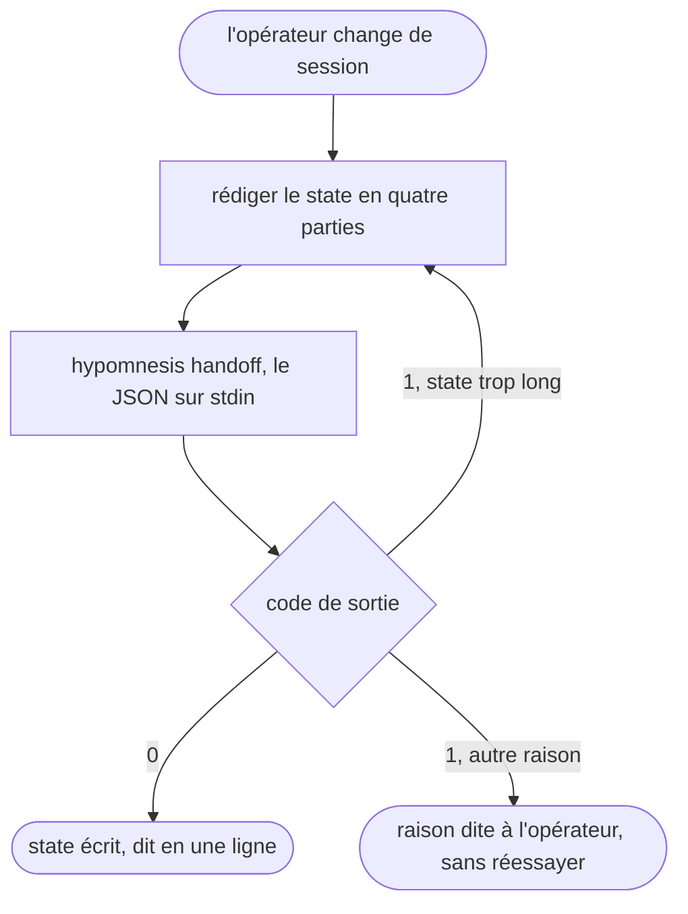

# hypomnesis-handoff — passer la main à la session suivante

L'opérateur quitte cette session pour une autre. Le skill écrit l'état du projet, le `state`, que la session suivante du même projet recevra au démarrage, puis rend la main.



## Process

1. **Rédiger le `state`.** Ce que git et la mémoire du projet ne disent pas, en quatre parties courtes :
   - **Où on en est** : la tâche en cours et l'étape atteinte.
   - **Ce qui est décidé** : les choix faits pendant la session, avec leur raison en une ligne.
   - **Ce qui bloque** : l'obstacle, ou « rien ».
   - **Ce qui reste** : les prochaines actions, dans l'ordre.
   - Bornes, refusées au-delà : `title` d'une ligne, au plus 80 caractères, et `body` d'au plus 1 200 caractères.
2. **Appeler la commande.** `hypomnesis handoff` lit un objet JSON `{"title", "body"}` sur son entrée standard. Les retours à la ligne du `body` s'écrivent `\n` dans le JSON :

   ```bash
   hypomnesis handoff <<'EOF'
   {"title": "Export CSV : parseur écrit, tests d'intégration à finir", "body": "Où on en est : le parseur lit les trois formats.\nDécidé : les dates restent en UTC, le front les convertit.\nBloque : rien.\nReste : les tests d'intégration, puis la doc."}
   EOF
   ```

3. **Lire le code de sortie.**
   - `0` : le `state` est écrit et l'ancien est invalidé. Le dire en une ligne à l'opérateur.
   - `1` : rien n'est écrit, la raison est sur la sortie d'erreur. Un `state` trop long se raccourcit puis se renvoie. Une session sans projet déclaré, ou que hypomnesis n'a pas enregistrée à son démarrage, ne peut pas passer la main : le dire à l'opérateur sans réessayer.

## Transversal rules

- **Ne recopier ni l'historique git ni la mémoire du projet.** Les commits se relisent avec `git log`, la mémoire est dans `aidd_docs/memory/`, `CLAUDE.md` ou `AGENTS.md`. Si cette mémoire contredit ce que la session a vécu, le signaler dans le `state`.
- **Aucun argument à la commande.** Elle retrouve la session et son projet par ses processus parents, jamais par le dossier courant.
- **Le contrat de la commande fait foi.** Bornes, format et codes de sortie sont ceux du `README.md` d'hypomnesis. S'ils changent là-bas, ce skill suit.

## Test

Se rejoue dans un dépôt déclaré dans `~/.config/hypomnesis/config.toml`, sous un agent dont le démarrage appelle `hypomnesis inject` (le hook `SessionStart` sous Claude Code).

| Cas | Preuve |
| --- | --- |
| « je bascule » dans une session enregistrée | `hypomnesis handoff` rend `0`, et `hypomnesis report` compte un `handoff` à `ok` |
| une session neuve du même projet | son contexte de démarrage porte le `title` et le `body` écrits |
| un `body` de plus de 1 200 caractères | code `1`, le skill raccourcit et renvoie, un seul `state` valide à la fin |
| un dépôt non déclaré, ou un agent sans adaptateur hypomnesis | code `1`, la raison est dite, aucune nouvelle tentative |
